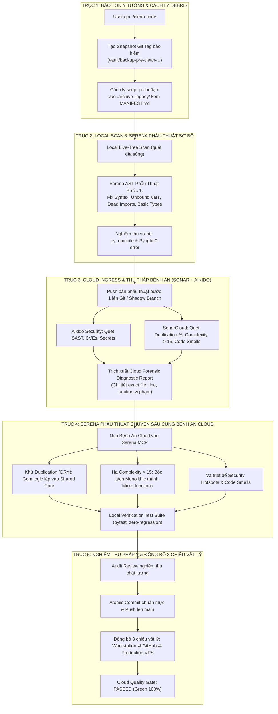

# 🧹 Clean Code 5-Axis Enterprise Engine (Dual-Surgery Closed-Loop Architecture)

> **Hệ Thống Quy Hoạch Kiến Trúc & Triệt Tiêu Nợ Kỹ Thuật Khép Kín 5 Trục (Dual-Surgery Closed-Loop)**
> Giải quyết triệt để bài toán: **"Code đĩa sống 1 nẻo, Git 1 nẻo, rác ngổn ngang nhưng sợ mất ý tưởng; thiếu vòng lặp phản hồi bệnh án từ Cloud về Serena để phẫu thuật triệt để"**.
> Kết hợp khép kín: `Idea Vault` $\rightarrow$ `Serena Initial Surgery` $\rightarrow$ `SonarCloud & Aikido Cloud Scan` $\rightarrow$ `Serena Deep Surgery` $\rightarrow$ `Forensic Audit & 3-Way Sync`.

---

## ⚡ CÁC LỆNH SLASH COMMAND ĐIỀU KHIỂN

| Lệnh Slash | Cú pháp thực thi | Hành động nghiệp vụ chi tiết |
| :--- | :--- | :--- |
| **`/clean-code`** | `/clean-code [all \| path]` | **Quy hoạch khép kín 5 trục toàn diện**: Tự động chụp Snapshot bảo hiểm $\rightarrow$ Cách ly rác $\rightarrow$ Serena phẫu thuật AST bước 1 $\rightarrow$ Đẩy Cloud để Sonar/Aikido quét bệnh án $\rightarrow$ Serena nhận bệnh án phẫu thuật chuyên sâu $\rightarrow$ Nghiệm thu & Đồng bộ 3 chiều. |
| **`/clean-code:vault`** | `/clean-code:vault` | **Trục 1 - Cách ly rác & Bảo hiểm ý tưởng**: Chụp Git Tag snapshot, di chuyển toàn bộ file `.bundle`, `.b64`, script thử nghiệm rải rác vào `.archive_legacy/` kèm Manifest. Không sửa code nghiệp vụ. |
| **`/clean-code:audit`** | `/clean-code:audit [dir]` | **Trục 2 - Sơ khám đĩa sống**: Quét trực tiếp file trên ổ đĩa (bất chấp Git chưa commit), phân loại Secrets, Cognitive Complexity > 15, Type annotations, và Dead Code. |
| **`/clean-code:cloud`** | `/clean-code:cloud` | **Trục 3 - Đẩy Cloud & Thu thập bệnh án**: Push bản phẫu thuật bước 1 lên GitHub để SonarCloud & Aikido phân tích; trích xuất danh sách file/hàm vi phạm Duplication %, Complexity, và Security. |
| **`/clean-code:surgery`** | `/clean-code:surgery [issue]` | **Trục 4 - Serena giải phẫu chuyên sâu**: Nạp trực tiếp bệnh án từ Cloud vào Serena MCP; bóc tách hàm phức tạp, khử trùng lặp mã (DRY), vá security rating theo đúng khuyến nghị của Sonar & Aikido. |
| **`/clean-code:sync`** | `/clean-code:sync` | **Trục 5 - Nghiệm thu pháp y & Đồng bộ 3 chiều**: Chạy verification test suite (pytest), commit sạch lên `main`, đồng bộ bit-for-bit xuống Production VPS (`/root/live_trade` hoặc `/root/video_factory`). |

> [!IMPORTANT]
> **KỶ LUẬT THỰC THI 1-CHUYẾN TỰ ĐỘNG (AUTONOMOUS SINGLE-PASS MANDATE)**:
> Khi tiếp nhận lệnh `/clean-code`, Agent BẮT BUỘC thực thi liên tục 1 mạch khép kín từ **Trục 1 đến Trục 5**, tuyệt đối KHÔNG dừng lại hỏi xác nhận vụn vặt giữa các trục. Agent tự động bảo hiểm Snapshot, dọn rác cách ly, phẫu thuật sơ bộ, đẩy Cloud lấy bệnh án, dùng Serena giải phẫu chuyên sâu, chạy test suite, và nghiệm thu đồng bộ, chỉ báo cáo kết quả tổng kết cuối cùng kèm Báo Cáo Pháp Y (Forensic Health Report).

---

## 🏛️ SƠ ĐỒ QUY TRÌNH 5 TRỤC KHÉP KÍN (CLOSED-LOOP REFACTORING DAG)



---

## 📋 NỘI HÀM CHI TIẾT 5 TRỤC THỰC THI

### 1. Trục 1: Idea Vault Snapshot & Debris Quarantine (Bảo Tồn Ý Tưởng 100%)
* **Bảo hiểm Git Snapshot**: Tự động tạo checkpoint trước khi đụng vào 1 dòng code:
  ```bash
  git stash create
  git tag "vault/backup-pre-clean-$(date +%Y%m%d_%H%M%S)"
  ```
* **Cách ly Debris (Quarantine)**: 
  * Quét toàn bộ các file rác phát sinh trong quá trình vibe coding ở thư mục gốc: `*.bundle`, `*.b64`, `*.patch`, `*.pack`, các script một lần `call_boss_audit_round*.py`, `inspect_*.py`, `probe_*.py`.
  * Di chuyển an toàn vào `.archive_legacy/vibe_scratch_<DATE>/` kèm file `MANIFEST.md` mô tả.
  * **Cam kết**: Không bao giờ xóa vĩnh viễn (hard delete) các file chứa ý tưởng. Thư mục gốc sạch bóng 100%, mọi ý tưởng cũ đều có thể phục hồi ngay lập tức.

### 2. Trục 2: Local Live-Tree Scan & Serena AST Initial Surgery (Sơ Khám & Phẫu Thuật Bước 1)
* **Quét trực tiếp file đĩa sống (Local Live-Tree)** qua AST Scanner & Pyright:
  * Phân loại 3 vùng làm việc: Vùng A (Committed Baseline), Vùng B (Dirty / In-Flight Ideas), Vùng C (Untracked Sprawl).
* **Serena phẫu thuật bước đầu**:
  * Vá các lỗi cú pháp, `UnboundLocalError`, missing imports, type mismatches.
  * Dọn dẹp dead imports, chuẩn hóa interface khế ước.
  * Nghiệm thu tại chỗ: `python -m compileall` exit 0 & `s.lsp.get_diagnostics_for_file` 0 errors.

### 3. Trục 3: Cloud Ingress & Diagnostic Scan (Đẩy Lên SonarCloud & Aikido Quét Bệnh Án)
* **Đẩy bản phẫu thuật bước 1 lên Git** để kích hoạt động cơ Cloud chuyên dụng:
  * **SonarCloud (50k LOC Free Scope)**: Quét chi tiết Duplication density (`new_duplicated_lines_density`), Cognitive Complexity per function, Reliability & Security rating.
  * **Aikido Security (100% Free SaaS)**: Quét chuyên sâu SAST, SCA (lỗ hổng thư viện phụ thuộc CVEs), Secrets leak, IaC.
* **Agent truy vấn bệnh án Cloud**:
  * Trích xuất danh sách chính xác: File nào, dòng nào bị trùng lặp mã? Hàm nào có complexity > 15? Điểm nào bị cảnh báo Security Hotspot?

### 4. Trục 4: Deep Serena AST Collaborative Surgery (Phẫu Thuật Chuyên Sâu Cùng Serena)
* **Serena MCP nhận Bệnh Án Đích Danh từ Cloud**:
  * **Khử Trùng Lặp (DRY Surgery)**: Tách các khối mã giống nhau giữa các modules thành shared helper functions trong `quantflow/common/` hoặc `app/services/common/`. Đưa tỷ lệ duplication về $\le 3\%$.
  * **Hạ Độ Phức Tạp Nhận Thức**: Tách các hàm monolithic khổng lồ (complexity > 15) thành các hàm con đơn nhiệm, bảo toàn 100% logic nghiệp vụ bằng AST refactoring.
  * **Vá Lỗ Hổng Bảo Mật (Security Hardening)**: Khử toàn bộ các điểm chạm mà Aikido và Sonar đánh giá dưới mức chuẩn A.
* **Kiểm thử hồi quy chéo**: Chạy test suite dự án (`pytest`) trên Workstation để chứng minh 0 lỗi regression.

### 5. Trục 5: Forensic Audit, Verification & 3-Way Physical Sync (Nghiệm Thu & Đồng Bộ)
* **Chốt chặn nghiệm thu pháp y**:
  * Pyright LSP: 0 Errors.
  * Bytecode: Compile PASS.
  * Project Test Suite: 100% PASS.
* **Commit chuẩn mực & Push lên `main`**:
  * Kích hoạt SonarCloud & Aikido Quality Gate chuyển sang trạng thái **PASSED / GREEN**.
* **Đồng bộ hóa 3 chiều vật lý (Three-Way Physical Sync - Rule 126)**:
  * Workstation ⇄ GitHub ⇄ Production VPS (`/root/live_trade` hoặc `/root/video_factory`).
  * Kiểm tra `git status` trên VPS trả về `working tree clean`.
* **Xuất Báo Cáo Pháp Y (Forensic Health Report)**: Thống kê số lượng rác đã cách ly, số dòng mã duplication đã khử, điểm Complexity trước/sau phẫu thuật, và trạng thái Quality Gate.
