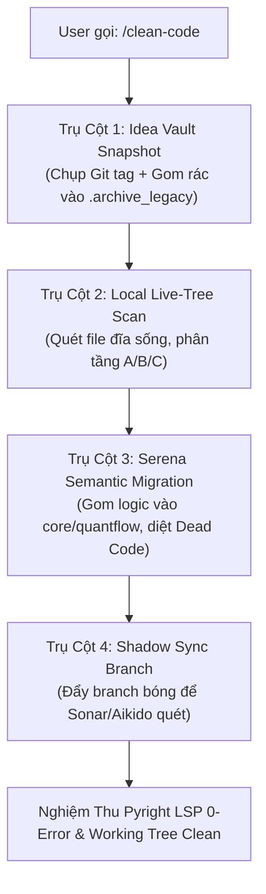

# 🧹 Clean Code 4-Pillar Enterprise Engine (Idea-Preserving Architecture)

> **Hệ Thống Quy Hoạch Kiến Trúc & Triệt Tiêu Nợ Kỹ Thuật Bảo Tồn Ý Tưởng 4 Trụ Cột**
> Giải quyết triệt để bài toán: **"Code đĩa sống 1 nẻo, Git 1 nẻo, rác ngổn ngang nhưng sợ mất ý tưởng"**.
> Kết hợp hoàn hảo: `Aikido Security` + `SonarCloud` + `Serena AST Engine` + `Git Safety Snapshot`.

---

## ⚡ CÁC LỆNH SLASH COMMAND ĐIỀU KHIỂN

| Lệnh Slash | Cú pháp thực thi | Hành động nghiệp vụ chi tiết |
| :--- | :--- | :--- |
| **`/clean-code`** | `/clean-code [all \| path]` | **Quy hoạch tổng thể 4 trụ cột**: Tự động chụp Snapshot bảo hiểm $\rightarrow$ Cách ly rác $\rightarrow$ Quét đĩa sống $\rightarrow$ Serena phẫu thuật AST $\rightarrow$ Nghiệm thu Pyright. |
| **`/clean-code:vault`** | `/clean-code:vault` | **Cách ly rác & Bảo hiểm ý tưởng**: Chụp Git Tag snapshot, di chuyển toàn bộ file `.bundle`, `.b64`, script thử nghiệm rải rác vào `.archive_legacy/` kèm Manifest. Không sửa code nghiệp vụ. |
| **`/clean-code:audit`** | `/clean-code:audit [dir]` | **Quét bệnh án đĩa sống (Local Live-Tree)**: Quét trực tiếp file trên ổ đĩa (bất chấp Git chưa commit), phân loại Secrets, Cognitive Complexity > 15, và Dead Code. |
| **`/clean-code:simplify`** | `/clean-code:simplify <func>` | **Phẫu thuật hạ độ phức tạp (Complexity $\le 15$)**: Serena bóc tách hàm monolithic (100–400 điểm complexity), tách thành các helper functions sạch mà không làm đổi logic. |
| **`/clean-code:sync`** | `/clean-code:sync` | **Đồng bộ quét Cloud an toàn (Shadow Branch)**: Đẩy snapshot code đĩa sống lên branch tạm `shadow/hygiene-audit` để SonarCloud & Aikido phân tích code mới nhất mà không làm bẩn `main`. |

---

## 🏛️ CHI TIẾT 4 TRỤ CỘT KIẾN TRÚC BẤT BIẾN

Khi tiếp nhận lệnh `/clean-code`, Agent bắt buộc tuân thủ tuần tự 4 trụ cột:



### 1. Trụ Cột 1: Idea Vault Snapshot & Debris Quarantine (Bảo Tồn Ý Tưởng 100%)
* **Bảo hiểm Git Snapshot**: Tự động tạo checkpoint trước khi đụng vào 1 dòng code:
  ```bash
  git stash create
  git tag "vault/backup-pre-clean-$(date +%Y%m%d_%H%M%S)"
  ```
* **Cách ly Debris (Quarantine)**: 
  * Quét toàn bộ các file rác phát sinh trong quá trình vibe coding ở thư mục gốc: `*.bundle`, `*.b64`, `*.patch`, `*.pack`, các script một lần `call_boss_audit_round*.py`, `inspect_*.py`, `probe_*.py`.
  * Di chuyển an toàn vào `.archive_legacy/vibe_scratch_<DATE>/` kèm file `MANIFEST.md` mô tả.
  * **Cam kết**: Không bao giờ xóa vĩnh viễn (hard delete) các file chứa ý tưởng. Thư mục gốc sạch bóng 100%, mọi ý tưởng cũ đều có thể phục hồi ngay lập tức.

### 2. Trụ Cột 2: Local Live-Tree Multi-Engine Scanner (Quét Trực Tiếp File Đĩa Sống)
* **Không phụ thuộc vào việc code đã commit hay chưa**:
  * Agent đọc trực tiếp từ FileSystem qua `scripts/code_hygiene_scanner.py` và `s.lsp`.
  * Phân loại 3 vùng làm việc qua `git status --porcelain`:
    * **Vùng A (Committed Baseline)**: Code đã có trên Git.
    * **Vùng B (Dirty / In-Flight Ideas)**: Các file đang sửa dở trong `quantflow/` hoặc `app/`, `vox/` $\rightarrow$ Đây là nơi chứa ý tưởng mới nhất, ưu tiên phân tích cao nhất!
    * **Vùng C (Untracked Sprawl)**: Các script và modules mới chưa theo dõi.
  * Bóc tách 4 chỉ số: Lộ Secrets (Aikido mirror), Cognitive Complexity > 15 (Sonar mirror), Dead Code candidates, Duplicated blocks (DRY).

### 3. Trụ Cột 3: Serena Semantic Migration & Surgical Refactoring
* **Chuyển hóa "Ý tưởng rời rạc" thành "Cấu trúc chuẩn"**:
  * Khi phát hiện logic có giá trị trong các script tạm: Serena trích xuất core logic, dùng `s.lsp.find_symbol` và `s.edit` đưa logic đó về đúng tầng kiến trúc:
    * *Trade System*: Logic nến/SMC $\rightarrow$ `quantflow/smc/`; Quản trị lệnh $\rightarrow$ `quantflow/execution/`; Backtest $\rightarrow$ `quantflow/backtest/`.
    * *AI Video Factory*: Logic kịch bản $\rightarrow$ `app/services/story_engine_b2.py`; Remotion props $\rightarrow$ `app/services/build_remotion_props.py`.
  * **Luật Thẩm Tra Chéo (Rule 138 - Blast Radius)**: Mọi hàm nghi ngờ là dead code bắt buộc phải chạy `s.lsp.find_referencing_symbols(symbol, path)` qua Pyright. Chỉ khi xác nhận `0 references` trên toàn bộ AST đồ thị mới thực hiện xóa an toàn (`s.lsp.safe_delete_symbol`).
  * **Hạ Độ Phức Tạp**: Các hàm có complexity > 15 được tách nhỏ thành các micro-functions sạch bằng `s.edit.replace_symbol_body`.

### 4. Trụ Cột 4: Shadow Sync Branch For Cloud Audit (Kiểm Toán Cloud Không Ô Nhiễm Main)
* Khi cần SonarCloud và Aikido kiểm toán trên Cloud có giao diện web:
  1. Agent tự động checkout branch bóng tạm thời: `git checkout -b shadow/hygiene-audit`
  2. Staging toàn bộ đĩa sống (kể cả ý tưởng uncommitted) và push lên GitHub remote: `git push -u origin shadow/hygiene-audit`
  3. GitHub Actions chạy SonarCloud & Aikido trên branch bóng này $\rightarrow$ Cho ra báo cáo 100% đúng với code thực tế trên máy bạn.
  4. Sau khi dọn dẹp sạch $\rightarrow$ Merge code sạch về `main` $\rightarrow$ Xóa branch bóng. Branch `main` luôn giữ độ thuần khiết tuyệt đối.

---

## 🛡️ V. QUY CHUẨN NGHIỆM THU ĐẦU RA (DEFINITION OF DONE)

Một phiên thực thi `/clean-code` chỉ được coi là HOÀN TẤT khi:
1. `s.lsp.get_diagnostics_for_file` qua Pyright trả về **0 Errors** trên tất cả các file đã sửa.
2. `python -m compileall -q .` biên dịch bytecode thành công không có SyntaxError.
3. Toàn bộ file rác tạm thời được đưa vào `.archive_legacy/`, thư mục gốc sạch sẽ.
4. Xuất Báo Cáo Pháp Y (Forensic Health Report) minh bạch: số file đã cách ly, số hàm đã giảm complexity, và trạng thái Git working tree.
