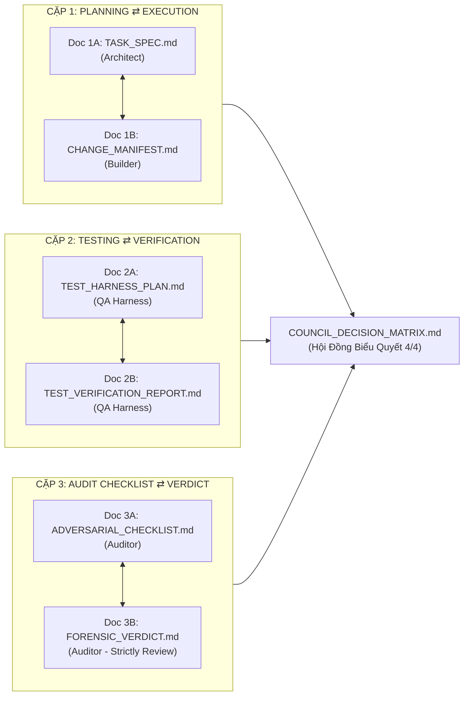

# 🛡️ VF Pipeline Multi-Agent Harness Council Engine (`/vf-pipeline-teamwork`)

> **Master Multi-Agent Harness & Council Engine** dành cho dây chuyền sản xuất video tự động **AI Video Factory (VF Pipeline)**.
> Vận hành theo mô hình Hội Đồng Độc Lập 4 Vai Trò, thẩm định đối kháng đồng thời (Simultaneous Verification), hệ thống 3 Cặp Tài Liệu Pháp Lý (Paired Docs), tích hợp **Alibaba Open Code Review (OCR)** và tuân thủ Hiến pháp **Rule 118 – Rule 136**.

---

## 🎯 I. HỘI ĐỒNG 4 VAI TRÒ ĐỘC LẬP (4 AUTONOMOUS COUNCIL ROLES)

Mọi tác vụ kỹ thuật, tái cấu trúc hoặc sửa đổi mã nguồn trong pipeline B1..B11 bắt buộc phân định rõ ràng ranh giới và thẩm quyền qua 4 vai trò:

| Vai Trò | Tôn Chỉ Vận Hành | Nhiệm Vụ Cốt Lõi | Cặp Tài Liệu Quản Trị |
| :--- | :--- | :--- | :--- |
| **1. Architect / Planner Agent** | *Defines What and Why, sets rigid boundaries.* | Bóc tách bài toán; thiết kế khế ước dữ liệu chuẩn `PIPELINE_CONTRACTS.md`; định rõ phạm vi In-Scope và ranh giới Non-Goals; phân tích đánh đổi kiến trúc (Rule 129). | **Doc 1A**: `TASK_SPEC.md`<br>(hoặc `IMPLEMENTATION_PLAN.md`) |
| **2. Builder / Implementer Agent** | *Implements Exactly to Spec, leaves zero ghosts.* | Viết mã, sửa lỗi, refactor bám sát 100% spec; tuân thủ Atomic Commit (Rule 124); chỉ dùng module chuẩn VPS, dọn sạch `/tmp/` (Rule 119); cấm script shadow / file `.bak*` (Rule 125); biên dịch AST `py_compile` exit code 0. | **Doc 1B**: `CHANGE_MANIFEST.md`<br>(kèm file:line diffs & SHA) |
| **3. QA & Test Harness Agent** | *Trust Nothing, verify dynamically with live data.* | Thiết lập ma trận test cases độc lập; chạy kiểm thử động trên sandbox/live data (Rule 123); thực thi ISO Neighbor-Testing, Master Smoke Gate, Runtime Live Function Gate (Rule 127); trích xuất bằng chứng pháp y Exit Code 0. | **Doc 2A**: `TEST_HARNESS_PLAN.md`<br>⇄<br>**Doc 2B**: `TEST_VERIFICATION_REPORT.md` |
| **4. Adversarial Forensic Auditor Agent** | *Red Team Mindset — Strictly Review-Only, Never Fixes Code.* | **CẤM TUYỆT ĐỐI SỬA MÃ**. Thẩm định tĩnh độc lập qua AST diff và Alibaba OCR Engine; kiểm toán 18 Kỷ luật thép (Rule 118 Zero-Mock, Rule 128 Anti-Bias, Rule 130/131 Docudrama, Rule 134 Exact Parity, Rule 136 Zero-Asset-Leak); chặn memory/FD leaks; **Nắm quyền Phủ Quyết Tuyệt Đối (Absolute VETO)**. | **Doc 3A**: `ADVERSARIAL_AUDIT_CHECKLIST.md`<br>⇄<br>**Doc 3B**: `FORENSIC_VERDICT.md` |

> [!IMPORTANT]
> **Cổng Three-Way Physical Sync Gate (Rule 126)**: Là cổng hậu kiểm kỹ thuật được Hội đồng cấp phép sau khi đạt **Quorum 4/4 Đồng Thuận Tuyệt Đối (Unanimous Approval)** để commit Git từ VPS, đẩy lên repo GitHub, theo dõi GitHub Actions CI Watcher `success`, và đối soát SHA256 bit-for-bit với Local/Notion.

---

## 📜 II. HỆ THỐNG 3 CẶP TÀI LIỆU PHÁP LÝ (PAIRED DOCS) & BIÊN BẢN HỘI ĐỒNG

Mọi quy trình can thiệp mã nguồn đều được bảo chứng qua 3 Cặp Tài Liệu Pháp Lý đối ứng hai chiều:



1. **Cặp 1 (Planning ⇄ Execution)**:
   - `TASK_SPEC.md`: Định nghĩa mục tiêu, khế ước giao diện, ranh giới sửa đổi và rủi ro.
   - `CHANGE_MANIFEST.md`: Báo cáo đối ứng liệt kê chính xác các file:line đã sửa, AST compile exit 0, cam kết zero-ghost code.
2. **Cặp 2 (Testing ⇄ Verification)**:
   - `TEST_HARNESS_PLAN.md`: Ma trận kịch bản kiểm thử (Unit, ISO Neighbor, Smoke, Boundary, Contract).
   - `TEST_VERIFICATION_REPORT.md`: Bằng chứng thực thi sống, stdout log, pass/fail rate, exit code 0.
3. **Cặp 3 (Audit Checklist ⇄ Forensic Verdict)**:
   - `ADVERSARIAL_AUDIT_CHECKLIST.md`: Bộ tiêu chuẩn đối kháng 18 Kỷ luật và OCR invariants.
   - `FORENSIC_VERDICT.md`: Phán quyết độc lập của Auditor (`CLEAR` hoặc `VETO`) với trích dẫn vi phạm cụ thể. Cấm viết code sửa chữa.
4. **Biên Bản Hội Đồng (`COUNCIL_DECISION_MATRIX.md`)**:
   - Ghi nhận đầy đủ 4 lá phiếu điện tử. Chỉ cấp phép `APPROVED_FOR_SYNC` khi đạt đồng thuận 4/4 không có VETO.
   - *Chi tiết biểu mẫu mẫu: Xem [doc_pairs_schema.md](./references/doc_pairs_schema.md).*

---

## ⚡ III. CƠ CHẾ THẨM ĐỊNH ĐỒNG THỜI (SIMULTANEOUS VERIFICATION PATTERN)

Khi Builder Agent nộp `CHANGE_MANIFEST.md`, hệ thống kích hoạt **đồng thời và độc lập** hai chốt chặn:

```
                  [Builder Agent nộp CHANGE_MANIFEST.md]
                                     │
                    ┌────────────────┴────────────────┐
                    ▼                                 ▼
         [QA & Test Harness Agent]       [Adversarial Forensic Auditor]
           (Kiểm thử động runtime)         (Kiểm toán tĩnh & đối kháng)
           - Chạy pytest unit tests        - Quét AST & Alibaba OCR Engine
           - Chạy ISO Neighbor-Testing     - Quét Rule 118 Zero-Mock Data
           - Chạy E2E Master Smoke Gate    - Quét Rule 128 Semantic Bias
           - Đo lường Memory & Latency     - Quét Rule 134 Text Parity
                    │                                 │
                    ▼                                 ▼
        [TEST_VERIFICATION_REPORT]           [FORENSIC_VERDICT]
                    └────────────────┬────────────────┘
                                     │
                                     ▼
                [Hội Đồng Họp Xét: COUNCIL_DECISION_MATRIX]
                - Có VETO / Defect  ➔ Trả về Builder sửa mã
                - Đạt 4/4 Unanimous ➔ Cấp phép Three-Way Sync
```

- **Triệt tiêu điểm mù (Anti-Bias)**: Auditor không bị chi phối bởi kết quả test pass của QA Agent; QA Agent không bị ảnh hưởng bởi nhận định chủ quan của Auditor.
- **Quyền VETO Tuyệt Đối**: Bất kỳ vi phạm Kỷ luật Thép nào (Rule 118 mock data, Rule 128 bias, Rule 125 ghost code, Rule 127 thiếu runtime test) đều lập tức kích hoạt lệnh **VETO**, buộc Builder phải sửa mã trong vòng lặp khép kín (tối đa 3 chu kỳ).
- *Chi tiết quy trình: Xem [harness_council_protocol.md](./references/harness_council_protocol.md).*

---

## 🚀 IV. CÚ PHÁP & RUNBOOK NHANH (INVOCATION RUNBOOK)

### 1. Chat UI Antigravity Slash Commands
```markdown
/vf-pipeline-teamwork council task:<EP_ID>      # Kích hoạt toàn bộ Hội Đồng 4 Agent cho task
/vf-pipeline-teamwork plan task:<EP_ID>         # Agent 1 lập TASK_SPEC.md & khế ước
/vf-pipeline-teamwork build task:<EP_ID>        # Agent 2 thực thi mã nguồn & nộp CHANGE_MANIFEST.md
/vf-pipeline-teamwork test task:<EP_ID>         # Agent 3 chạy trọn bộ Test Harness
/vf-pipeline-teamwork audit task:<EP_ID>        # Agent 4 kiểm toán đối kháng độc lập (chỉ review)
/vf-pipeline-teamwork review                    # Quét nhanh mã nguồn qua Alibaba OCR Engine
/vf-pipeline-teamwork ci                        # Chạy trọn bộ CI Quality Gates (ISO + Smoke + OCR)
/vf-pipeline-teamwork sync                      # Kích hoạt quy trình Đồng Bộ Vật Lý 3 Chiều (Rule 126)
```

### 2. Dòng Lệnh CLI Tiêu Chuẩn Trên VPS (`scripts/orchestrator/runner.py`)
```bash
python3 scripts/orchestrator/runner.py --mode council --task-id <EP_ID> # Xuất ma trận Hội Đồng
python3 scripts/orchestrator/runner.py --mode review                   # Chạy Open Code Review
python3 scripts/orchestrator/runner.py --mode ci                       # Chạy trọn bộ CI Quality Gates
python3 scripts/orchestrator/runner.py --mode sync                     # Kiểm tra & Đồng bộ 3 Chiều
python3 scripts/orchestrator/runner.py --mode pipeline --blocks 1.0..3.5 --task-id <EP_ID>
python3 scripts/orchestrator/runner.py --cleanup-tmp                   # Dọn sạch file rác /tmp (Rule 119)
```

*Ghi chú từ máy Windows qua VPS runner*:
```powershell
python scripts/vps_runner.py "python3 scripts/orchestrator/runner.py --mode review"
python scripts/vps_runner.py "python3 scripts/orchestrator/runner.py --mode ci"
python scripts/vps_runner.py "python3 scripts/orchestrator/runner.py --mode council --task-id <EP_ID>"
```

---

## 📚 V. TÀI LIỆU THAM CHIẾU CHUYÊN SÂU (PROGRESSIVE DISCLOSURE)

Để tối ưu hóa token và độ sâu ngữ cảnh, chỉ nạp thêm tài liệu chi tiết khi có nhu cầu:
- **Giao Thức Hội Đồng & State Machine**: Mở [harness_council_protocol.md](./references/harness_council_protocol.md) để tra cứu vòng đời task, quy chế biểu quyết và remediation loop.
- **Biểu Mẫu Chuẩn Các Cặp Tài Liệu**: Mở [doc_pairs_schema.md](./references/doc_pairs_schema.md) để lấy cấu trúc markdown cho 3 Cặp Tài Liệu và Biên Bản Hội Đồng.
- **Chi tiết từng Block B1.0 ➔ B11.0**: Mở [block_matrix.md](./references/block_matrix.md) khi cần phân nhiệm theo từng bước pipeline.
- **Chi tiết Quy Chuẩn & Cú Pháp OCR**: Mở [ocr_rules.md](./references/ocr_rules.md) khi cần cấu hình hoặc đối soát luật `.opencodereview/rule.json`.
- **Khế Ước Dữ Liệu Liên Khối (Data Schema)**: Tra cứu tại [PIPELINE_CONTRACTS.md](../../../PIPELINE_CONTRACTS.md).

---

## ⚖️ VI. KỶ LUẬT THÉP BẮT BUỘC (RULE 118 – RULE 136)

Mọi Agent trong Hội Đồng bắt buộc tuân thủ 100% Hiến pháp trong `AGENTS.md`:
1. **Rule 118 (Zero-Mock Data)**: Cấm tuyệt đối fake numbers / synthetic data.
2. **Rule 119 (Existing Codebase Only)**: Dọn sạch file tạm `/tmp/` sau khi thực thi.
3. **Rule 121 (Forensic Verification)**: Nghiệm thu bằng log HTTP 200, exit code 0, file:line rõ ràng.
4. **Rule 124 (Atomic Commitment)**: Chốt giải pháp là code ngay, cấm nói suông.
5. **Rule 125 (Single Truth & Zero-Ghost)**: Cấm file `.bak*`, diệt sạch logic cũ khi đổi luồng.
6. **Rule 126 (Three-Way Physical Sync)**: VPS ⇄ GitHub CI ⇄ Local bit-for-bit; GitHub Actions xanh 100%.
7. **Rule 127 (Runtime Live Execution)**: Cấm chỉ nghiệm thu qua `py_compile`, bắt buộc chạy thực thi hàm sống.
8. **Rule 128 (Generic Contract)**: Cấm hardcode tên tập/đề tài cụ thể vào schema & prompt.
9. **Rule 129 (Autonomous Deep Reasoning)**: Phân tích 3 trục kiến trúc & đánh đổi trước khi can thiệp.
10. **Rule 134 (Exact Parity Sweep)**: Quét nhất quán toàn diện codebase khi đổi hằng số cấu hình.
11. **Rule 136 (Zero-Asset-Leak)**: Cấm rò rỉ mã asset, hash, layer, đuôi `.png` lên video render.
