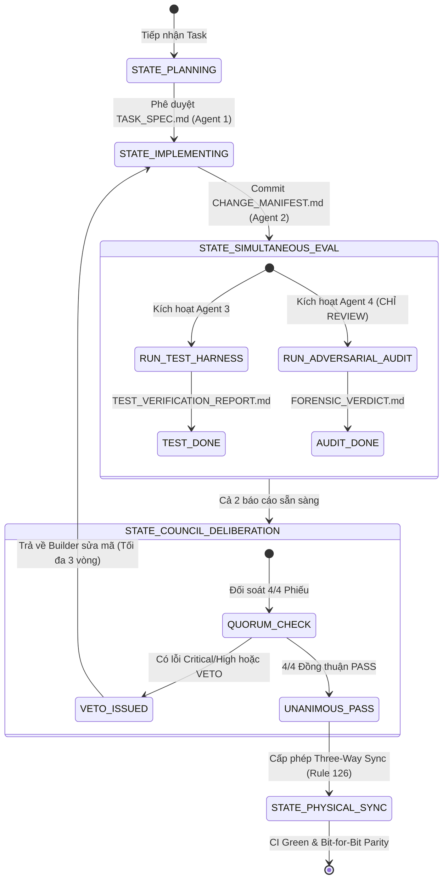

# 🏛️ VF Pipeline Multi-Agent Harness Council Protocol

> **Giao thức Vận Hành Hội Đồng Độc Lập & Test Harness (Council Protocol)** dành cho dây chuyền AI Video Factory.
> Thiết kế theo tiêu chuẩn công nghiệp về Multi-Agent Software Engineering, quản trị qua 4 vai trò độc lập, cơ chế thẩm định đồng thời và quyền phủ quyết (VETO) đối kháng.

---

## 🧭 I. TỔNG QUAN HỆ THỐNG HỘI ĐỒNG (COUNCIL OVERVIEW)

Hội đồng CI/CD Full Luồng của VF Pipeline gồm **4 Agent Chuyên Trách Độc Lập** phối hợp khép kín:



---

## 👥 II. 4 VAI TRÒ ĐỘC LẬP & TRÁCH NHIỆM PHÁP LÝ

### 1. Architect / Planner Agent (Vai 1: Kế Hoạch & Khế Ước)
- **Tôn chỉ**: *Defines What and Why, sets rigid boundaries.*
- **Nhiệm vụ**:
  - Bóc tách yêu cầu bài toán từ User Request hoặc Pipeline Block (B1..B11).
  - Thiết kế khế ước dữ liệu chuẩn hóa (Input/Output Schemas theo `PIPELINE_CONTRACTS.md`).
  - Định hình phạm vi can thiệp (In-Scope Files), chỉ định rõ ranh giới cấm chạm (Non-Goals / Out-of-Scope).
  - Phân tích rủi ro kỹ thuật, đánh đổi kiến trúc (Rule 129 Trade-offs) và ma trận biên giới.
- **Sản phẩm bàn giao**: `TASK_SPEC.md` (hoặc `IMPLEMENTATION_PLAN.md`).

### 2. Builder / Implementer Agent (Vai 2: Thực Thi & Sửa Mã)
- **Tôn chỉ**: *Implements Exactly to Spec, leaves zero ghosts.*
- **Nhiệm vụ**:
  - Viết code, tái cấu trúc hoặc sửa lỗi bám sát 100% tài liệu `TASK_SPEC.md`.
  - Tuân thủ nguyên tắc Atomic Commit (Rule 124): chốt là code ngay, không để sót TODO.
  - Tuân thủ Rule 119 (chỉ dùng module chuẩn VPS, dọn sạch `/tmp/`) và Rule 125 (Single Truth, diệt sạch shadow code, cấm file `.bak*`).
  - Kiểm tra cú pháp AST sạch bằng `python3 -m py_compile`.
- **Sản phẩm bàn giao**: `CHANGE_MANIFEST.md` (kèm line diffs và SHA checksum).

### 3. QA & Test Harness Agent (Vai 3: Viết Test Case & Kiểm Thử Động)
- **Tôn chỉ**: *Trust Nothing, verify dynamically with live data.*
- **Nhiệm vụ**:
  - Soạn thảo ma trận kiểm thử độc lập (`TEST_HARNESS_PLAN.md`) bao gồm: Unit test, ISO Neighbor-Testing, Master Smoke Gate, Boundary Stress Test.
  - Thực thi kiểm thử động trên môi trường thực tế (Rule 123 Live Data, Rule 127 Runtime Execution).
  - Thu thập đầy đủ bằng chứng pháp y: mã thoát `Exit Code 0`, log `stdout`/`stderr`, thời gian thực thi (duration).
- **Sản phẩm bàn giao**: `TEST_VERIFICATION_REPORT.md`.

### 4. Adversarial Forensic Auditor Agent (Vai 4: Chỉ Review Đối Kháng & Quyền VETO)
- **Tôn chỉ**: *Red Team Mindset — Strictly Review-Only, Never Fixes Code.*
- **Nhiệm vụ**:
  - **CẤM TUYỆT ĐỐI VIẾT CODE SỬA CHỮA**: Auditor chỉ thẩm định, phát hiện vi phạm và ban hành phán quyết.
  - Thẩm định mã nguồn tĩnh qua AST, Alibaba Open Code Review (OCR Engine) và git diff.
  - Kiểm toán 18 Kỷ Luật Thép (`AGENTS.md` Rule 118 – Rule 136):
    - *Rule 118*: Phát hiện và chặn đứng mọi mock data, số liệu giả định.
    - *Rule 122*: Thẩm định visual 4 trục khi audit các block đồ họa (B4/B5).
    - *Rule 128*: Quét sạch hardcoded domain bias, case study tropes trong prompt/schema.
    - *Rule 130/131*: Thẩm định kịch bản 5 Beat, An Ong Hook 60s, không mở đầu bằng "Imagine".
    - *Rule 134*: Quét nhất quán văn bản toàn diện (Full-Text Consistency Sweep).
    - *Rule 136*: Chặn đứng rò rỉ asset key, layer hash, đuôi `.png` lên video render.
  - Quản trị tiêu chí OCR: Chặn memory leaks, unclosed file descriptors, ReDoS regex, bare excepts.
- **Quyền hạn đặc biệt**: Nắm giữ **Quyền Phủ Quyết Tuyệt Đối (Absolute VETO)**. Nếu phát hiện >= 1 lỗi `CRITICAL` hoặc `HIGH`, Auditor có quyền dừng toàn bộ quy trình merge.
- **Sản phẩm bàn giao**: `FORENSIC_VERDICT.md`.

---

## ⚡ III. CƠ CHẾ THẨM ĐỊNH ĐỒNG THỜI (SIMULTANEOUS VERIFICATION)

Để loại trừ hoàn toàn điểm mù nhận thức (Cognitive Blind Spots) và hiện tượng thông đồng (Agent Collusion), quy trình thẩm định được thiết kế chạy **ĐỒNG THỜI VÀ ĐỘC LẬP**:

```
          [Builder Agent commits CHANGE_MANIFEST.md]
                             │
            ┌────────────────┴────────────────┐
            ▼                                 ▼
   [QA & Test Harness]              [Adversarial Auditor]
   - Chạy test động                 - Rà soát mã tĩnh
   - Đánh giá Functional Pass       - Rà soát 18 Kỷ Luật Thép
   - Đo lường Runtime Invariants    - Chạy OCR Engine & AST
            │                                 │
            ▼                                 ▼
  [TEST_VERIFICATION_REPORT]         [FORENSIC_VERDICT]
            └────────────────┬────────────────┘
                             │
                             ▼
               [Council Deliberation & Voting]
```

### Nguyên Tắc Hoạt Động Song Song:
1. **Không Chờ Đợi**: QA Test Agent và Adversarial Auditor nhận cùng lúc bản commit diff từ Builder và chạy song song.
2. **Độc Lập Đánh Giá**:
   - QA Agent không được xem trước nhận định của Auditor để tránh bị thiên kiến.
   - Auditor không được hạ thấp tiêu chuẩn kiểm toán chỉ vì thấy bài test của QA Agent đã báo "PASS".
3. **Phản Biện Đối Kháng**: Auditor chủ động tìm kiếm các trường hợp biên (edge cases) mà bộ test case của QA Agent có thể đã bỏ sót.

---

## ⚖️ IV. MA TRẬN BIỂU QUYẾT & GIẢI QUYẾT XUNG ĐỘT (QUORUM & REMEDIATION)

### 1. Quy Tắc Biểu Quyết Cấp Phép (Quorum Rule)
Cổng Three-Way Physical Sync (Rule 126) CHỈ được phép mở khi Hội đồng đạt:
$$\text{Council Quorum} = \text{Unanimous Approval } (4/4 \text{ PASS})$$

| Vai Trò | Điều Kiện Bỏ Phiếu `AGREE / PASS` |
| :--- | :--- |
| **Architect** | Bản thay đổi giải quyết đúng 100% mục tiêu trong `TASK_SPEC.md`, không gây phá vỡ khế ước dữ liệu. |
| **Builder** | Mã nguồn đã ghi xuống đĩa, AST compile exit code 0, không còn tàn dư file rác. |
| **Test Harness** | 100% test cases trong `TEST_HARNESS_PLAN.md` đạt PASS, Exit Code 0, live runtime verified. |
| **Adversarial Auditor** | 0 lỗi `CRITICAL`, 0 lỗi `HIGH`, tuân thủ 100% Rule 118–136, ban hành phán quyết `CLEAR`. |

### 2. Vòng Lặp Khắc Phục Lỗi (Remediation Loop)
1. **Kích hoạt khi**: Có phiếu `DISAGREE` từ Architect, `FAIL` từ Test Agent, hoặc lệnh `VETO` từ Auditor.
2. **Quy trình xử lý**:
   - Auditor và Test Agent xuất bảng lỗi chi tiết (kèm `file:line` và nguyên nhân vi phạm) vào `COUNCIL_DECISION_MATRIX.md`.
   - Task tự động chuyển trạng thái ngược về `STATE_IMPLEMENTING`.
   - Builder Agent nhận danh sách khuyết tật, thực hiện vá mã và nộp bản diff mới.
   - Hội đồng thẩm định lại từ đầu giai đoạn thẩm định đồng thời.
3. **Giới hạn an toàn**: Tối đa **3 vòng lặp khắc phục** cho một task. Nếu sau 3 lần vẫn chưa đạt Unanimous PASS, hệ thống BẮT BUỘC dừng lại và kích hoạt Cổng Phản Vấn Chủ Động để tham vấn User theo **Rule 118 & Rule 129**.
