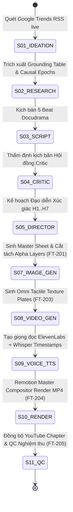

# 📜 01_CONTRACTS.md - KHẾ ƯỚC DỮ LIỆU VIDEO FACTORY (SSOT)

> **NGUỒN SỰ THẬT DUY NHẤT CHO PIPELINE S1–S11 & VOX ENGINE V3.**
> Mọi thay đổi về cấu trúc kịch bản, đạo diễn xúc giác, hay render Remotion bắt buộc phải khai báo ở đây.
> Tuân thủ Hiến pháp R118 (Zero-Mock), R128 (Generic Contract), R132 (Decoupled Engine), và R140 (Kinetic Coupling).

---

## 1. STATE MACHINE PIPELINE CHUẨN (CANONICAL PIPELINE 2.0)


---

## 2. PYDANTIC SCHEMAS CHUẨN TẮC

```python
from pydantic import BaseModel, Field
from typing import List, Optional, Dict, Any

# ==============================================================================
# [FT-201] MASTER SHEET ASSET BUNDLE SCHEMA (COMPREHENSIVE 6-IN-1)
# ==============================================================================
class WiringSpec(BaseModel):
    """Khế ước cách đấu nối không gian & động học giữa các object."""
    connector_type: str = Field(..., description="Loại đấu nối: red_yarn, brass_caliper, turned_wood_seal, index_arrow")
    source_anchor: List[int] = Field(..., description="Tọa độ điểm neo nguồn [x, y] trên khung 1920x1080")
    target_anchor: List[int] = Field(..., description="Tọa độ điểm neo đích [x, y] trên khung 1920x1080")
    ingress_axis: str = Field(default="X", description="Trục chuyển động vào (X đơn hướng)")
    ingress_duration_sec: float = Field(default=0.3, le=0.4, description="Thời gian bứt tốc vào sân khấu (<= 0.4s)")
    hold_fps: int = Field(default=12, description="Tốc độ vi rung nhịp thở stop-motion (12fps on twos)")
    snappy_physics: bool = Field(default=True, description="Khóa cứng gia tốc stop-motion giật dứt khoát")

class InformationSpec(BaseModel):
    """Khế ước thông tin nội dung & dữ liệu định lượng."""
    headline: str = Field(..., description="Tiêu đề phân cảnh điều tra")
    stat_hero: str = Field(..., description="Con số định lượng khổng lồ màu đỏ (ví dụ: '500+', '9 RETAIL')")
    stat_label: str = Field(..., description="Nhãn định danh con số định lượng")
    narration: str = Field(..., description="Toàn văn lời đọc voiceover")

class MasterSheetAssetBundle(BaseModel):
    """
    Khế ước Bộ linh kiện Master Sheet toàn diện 6-trong-1 (FT-201).
    BẮT BUỘC có đủ: (1) Image Result, (2) Object Chủ thể, (3) Object Tương tác,
    (4) Thông tin, (5) Transaction Prompt, và (6) Cách đấu nối.
    Thiếu bất kỳ thành phần nào sẽ fail-closed ngay lập tức.
    """
    scene_id: str = Field(..., pattern=r"^SCENE_\d{2}$")
    assembled_anchor_url: str = Field(..., description="1. Image Result mong muốn: Ảnh kết quả tổng thành 2560x1440")
    hero_cutout_url: str = Field(..., description="2. Object Chủ thể: Ảnh tài liệu/nhân vật trên nền trắng #FFFFFF có Alpha")
    interacting_tool_url: str = Field(..., description="3. Object Tương tác: Ảnh thước kẹp/con dấu/chỉ đỏ trên nền trắng #FFFFFF có Alpha")
    stage_backdrop_url: str = Field(default="", description="Ảnh nền sân khấu bàn làm việc (#F4F1EA)")
    stat_card_url: str = Field(default="", description="Ảnh thẻ số liệu đỏ (#D62E1F) hoặc vector chip")
    connector_url: str = Field(default="", description="Ảnh hoặc vector sợi chỉ đỏ / thước kẹp kết nối")
    information_spec: InformationSpec = Field(..., description="4. Thông tin: Headline, stat hero, narration")
    transaction_prompt: str = Field(..., description="5. Transaction Prompt: Prompt tương tác cơ học xúc giác cho Omni/Veo plate")
    wiring_spec: WiringSpec = Field(..., description="6. Cách đấu nối: Tọa độ điểm neo source/target, loại connector, ingress <= 0.4s")
    ingress_direction: str = Field(default="screen_right_to_left", description="Hướng trượt vào duy nhất")
    ingress_duration_sec: float = Field(default=0.3, le=0.4, description="Thời gian bứt tốc vào sân khấu (<= 0.4s)")
    camera_movement: str = Field(default="locked", description="Khóa cứng khung máy tính 1920x1080, cấm zoom/pan")

# ==============================================================================
# [FT-203] OMNI TACTILE TEXTURE PLATE SCHEMA
# ==============================================================================
class OmniTactilePlate(BaseModel):
    """
    Khế ước Clip chất liệu môi trường động sinh từ Omni 1.1 Flash / Veo (FT-203).
    Chỉ dùng làm background plate hoặc overlay thớ giấy sống; CẤM giao layer cho Omni.
    """
    scene_id: str = Field(..., pattern=r"^SCENE_\d{2}$")
    plate_type: str = Field(..., regex=r"^(paper_grain|crt_scanline|archival_fume|desk_surface)$")
    prompt_used: str = Field(..., description="Bắt buộc có tiền tố 'Locked static computer screen frame, no zoom'")
    video_clip_url: str = Field(..., description="Đường dẫn file MP4 1280x720 hoặc 1920x1080")
    duration_sec: float = Field(..., ge=3.0, le=10.0)
    temporal_motion_delta: float = Field(..., ge=0.5, description="Độ biến thiên pixel tối thiểu (chống freeze-frame)")

# ==============================================================================
# [FT-204] REMOTION SCENE RENDER PROPS SCHEMA
# ==============================================================================
class RemotionSceneProp(BaseModel):
    """
    Khế ước Đạo diễn Phân cảnh Remotion kết hợp Master Sheet + Omni Plate (FT-204).
    """
    scene_id: str = Field(...)
    duration_in_frames: int = Field(..., ge=30)
    headline: str = Field(...)
    stat_value: str = Field(...)
    stat_label: str = Field(...)
    background_plate_src: str = Field(..., description="Đường dẫn Omni Tactile Plate hoặc Master Stage")
    hero_src: str = Field(..., description="Hero cutout PNG alpha")
    stat_card_src: str = Field(..., description="Stat card PNG alpha")
    ingress_axis: str = Field(default="X", description="Trục chuyển động trượt vào")
    ingress_duration_sec: float = Field(default=0.3, le=0.4)
    camera_movement: str = Field(default="locked")
    yarn_connections: List[Dict[str, Any]] = Field(default_factory=list, description="Khóa khớp chỉ đỏ nối chủ thể")
    whisper_subtitles: List[Dict[str, Any]] = Field(default_factory=list, description="Phụ đề word-level sync")

# ==============================================================================
# [FT-206] OPUS 5.5 DYNAMIC ART DIRECTOR & TACTILE CONTACT KINEMATICS SCHEMA
# ==============================================================================
class TactileContactPoint(BaseModel):
    """Điểm chạm cơ học do Opus 5.5 quyết định."""
    anchor_type: str = Field(..., description="Loại điểm chạm: corner_pin, edge_clip, center_stamp, slice_seam, highlight_band, catenary_yarn")
    host_target_area: str = Field(..., description="Vùng tiếp xúc trên Host: top_right_corner, left_margin, document_face, paragraph_body, bottom_seal_zone")
    contact_frame_offset: int = Field(default=12, ge=0, le=120, description="Frame tạo va chạm cơ học (12fps step motion)")
    physical_residue: str = Field(..., description="Tồn dư để lại: red_ink_stain, yellow_glow, paper_tear, needle_hole, embossed_crease")
    snappy_impact_damping: float = Field(default=0.75, ge=0.0, le=1.0, description="Hệ số nảy va chạm stop-motion")

class DynamicMacroCamera(BaseModel):
    """Quy chuẩn camera Macro Punch-In do Opus 5.5 chỉ đạo."""
    start_scale: float = Field(default=1.0, ge=0.5, le=2.0)
    target_scale: float = Field(default=1.35, ge=1.1, le=1.6, description="Độ zoom cận cảnh vào điểm chạm")
    focal_point_norm: List[float] = Field(..., description="Tọa độ tiêu điểm chuẩn hóa [norm_x, norm_y] từ 0.0 đến 1.0 (len == 2)")
    transition_punch_through: bool = Field(default=True, description="Phóng sâu choán màn hình rồi match-cut sang scene sau")

class DynamicMasterArtManifest(BaseModel):
    """
    Khế ước Mỹ thuật Độc bản do Opus 5.5 / Astra 6 sinh ra cho từng Scene.
    BẮT BUỘC viết thuần chuẩn kỹ thuật cho AI, không văn xuôi giải trí (Rule 128, 132).
    """
    scene_id: str = Field(..., pattern=r"^SCENE_\d{2}$")
    narrative_rationale: str = Field(..., description="Lý do lựa chọn ngôn ngữ thị giác dựa trên kịch bản")
    
    # Prompts thuần AI cho tầng sinh ảnh
    assembled_keyframe_prompt: str = Field(..., description="Prompt AI vẽ Ảnh Full Hoàn Chỉnh đỉnh cao")
    hero_cutout_prompt: str = Field(..., description="Prompt AI vẽ Chủ thể cô lập trên nền trắng #FFFFFF")
    interacting_tool_prompt: str = Field(..., description="Prompt AI vẽ Đạo cụ tương tác cô lập trên nền trắng #FFFFFF")
    
    # Chỉ đạo bóc tách & động học do chính Opus 5.5 quyết định
    contact_point: TactileContactPoint = Field(..., description="Quy cách điểm chạm cơ học")
    macro_camera: DynamicMacroCamera = Field(..., description="Chỉ đạo camera macro punch-in")
    ingress_direction: str = Field(default="right_to_left", description="Hướng bứt tốc vào sân khấu")
    ingress_duration_sec: float = Field(default=0.3, le=0.4, description="Thời gian bứt tốc <= 0.4s")
    dual_pass_shadow: bool = Field(default=True, description="Bắt buộc đổ bóng tiếp xúc kép")

# ==============================================================================
# [FT-207] CONTINUOUS VOX DESKWORLD & CAMERA JOURNEY SCHEMA (VOX ENGINE V3)
# ==============================================================================
class DeskStationAnchor(BaseModel):
    """Tọa độ trạm khảo sát trên bàn điều tra mở rộng (World Canvas 3840x2160)."""
    station_id: str = Field(..., pattern=r"^STATION_\d{2}$")
    scene_id: str = Field(..., pattern=r"^SCENE_\d{2}$")
    center_x: float = Field(..., description="Tọa độ X trung tâm trạm trên bàn điều tra (pixels)")
    center_y: float = Field(..., description="Tọa độ Y trung tâm trạm trên bàn điều tra (pixels)")
    camera_zoom: float = Field(default=1.0, ge=0.7, le=1.8, description="Hệ số zoom của camera khi đỗ tại trạm")
    dwell_duration_sec: float = Field(..., ge=3.0, description="Thời gian khảo sát tại trạm")
    hero_spec: Dict[str, Any] = Field(..., description="Chủ thể bằng chứng thực tế (loại bỏ 100% chip TSMC và clutter)")
    evidence_nodes: List[Dict[str, Any]] = Field(default_factory=list, description="Các node bằng chứng vệ tinh")
    semantic_yarns: List[Dict[str, Any]] = Field(default_factory=list, description="Dây chỉ đỏ nối trực tiếp giữa các trạm")

class CameraTransitionCurve(BaseModel):
    """Khế ước chuyển động máy quay giữa 2 trạm (Pan/Zoom mượt mà thay thế Hard-Cut)."""
    from_station_id: str
    to_station_id: str
    transition_start_sec: float
    transition_duration_sec: float = Field(default=1.2, ge=0.8, le=2.0)
    pan_spring_preset: str = Field(default="opuscarContinuousPan")
    lead_connector_id: Optional[str] = Field(None, description="Sợi chỉ đỏ dẫn hướng camera sang trạm tiếp theo")

class ContinuousDeskWorldProps(BaseModel):
    """Khế ước tổng thể toàn Act của Bàn Điều Tra Liên Tục (FT-207)."""
    act_id: str = Field(..., pattern=r"^ACT_\d{2}$")
    world_width: int = Field(default=3840, ge=1920)
    world_height: int = Field(default=2160, ge=1080)
    desk_material: str = Field(default="aged_newsprint_kraft")
    stations: List[DeskStationAnchor] = Field(..., min_items=2)
    camera_transitions: List[CameraTransitionCurve] = Field(default_factory=list)
    word_timestamps: List[Dict[str, Any]] = Field(default_factory=list)

# ==============================================================================
# MASTER EPISODE CONTEXT (SINGLE SOURCE OF TRUTH)
# ==============================================================================
class EpisodeContext(BaseModel):
    episode_id: str = Field(..., pattern=r"^[A-Z]{2}_EP\d{4}_[a-z0-9_]+$")
    topic_slug: str
    total_scenes: int = Field(..., ge=1)
    target_fps: int = Field(default=30)
    master_sheet_bundles: Dict[str, MasterSheetAssetBundle]
    tactile_plates: Dict[str, OmniTactilePlate]
    render_props: Optional[Dict[str, Any]] = None
    karaoke_drift_tolerance_ms: int = Field(default=0, description="Dung sai lệch audio = 0ms")
```
