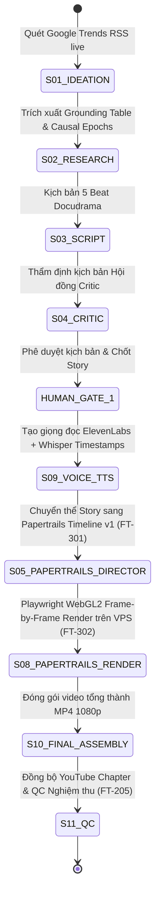

# 📜 01_CONTRACTS.md - KHẾ ƯỚC DỮ LIỆU VIDEO FACTORY (SSOT)

> **NGUỒN SỰ THẬT DUY NHẤT CHO PIPELINE S1–S11 & PAPERTRAILS 3D ENGINE.**
> Mọi thay đổi về cấu trúc kịch bản, đạo diễn thế giới giấy 3D, hay render VPS bắt buộc phải khai báo ở đây.
> Tuân thủ Hiến pháp R118 (Zero-Mock), R128 (Generic Contract), R132 (Decoupled Engine), và R140 (Kinetic Coupling).

---

## 1. STATE MACHINE PIPELINE CHUẨN (CANONICAL PIPELINE 2.0 - PAPERTRAILS REVOLUTION)


---

## 2. PYDANTIC SCHEMAS CHUẨN TẮC

```python
from pydantic import BaseModel, Field
from typing import List, Optional, Dict, Any, Union

# ==============================================================================
# [FT-301] PAPERTRAILS 3D TIMELINE SCHEMA (CANONICAL V1 - SSOT)
# ==============================================================================
class PapertrailsCaptionWord(BaseModel):
    """Khế ước từ vựng đồng bộ âm thanh phục vụ highlight đỏ chữ karaoke."""
    word: str = Field(..., description="Từ đơn hoặc cụm từ")
    start: float = Field(..., ge=0.0, description="Thời điểm bắt đầu (giây)")
    end: float = Field(..., ge=0.0, description="Thời điểm kết thúc (giây)")

class PapertrailsCaption(BaseModel):
    """Khế ước dải phụ đề giấy rách torn-paper."""
    start: float = Field(..., ge=0.0, description="Mốc thời gian bắt đầu")
    end: float = Field(..., ge=0.0, description="Mốc thời gian kết thúc")
    text: str = Field(..., description="Toàn văn câu phụ đề")
    words: Optional[List[PapertrailsCaptionWord]] = Field(default=None, description="Danh sách từ đồng bộ karaoke")

class PapertrailsSceneCard(BaseModel):
    """Khế ước thẻ giấy dán đè trên sân khấu 3D (note hoặc photo)."""
    kind: str = Field(..., regex=r"^(note|photo)$", description="Loại thẻ: note hoặc photo")
    head: Optional[str] = Field(default=None, description="Tiêu đề thẻ ghi chú")
    lines: Optional[List[str]] = Field(default=None, description="Các dòng nội dung ghi chú (hỗ trợ code backtick)")
    numbered: Optional[bool] = Field(default=True, description="Hiển thị số thứ tự")
    side: str = Field(default="right", regex=r"^(left|right|center)$", description="Vị trí hiển thị thẻ")
    big: Optional[bool] = Field(default=False, description="Chế độ thẻ chương lớn (khi ở giữa)")
    lineAt: Optional[List[float]] = Field(default=None, description="Mốc thời gian hiện từng dòng (giây)")
    img: Optional[str] = Field(default=None, description="Data URI base64 của ảnh tư liệu (dành cho photo)")
    aspect: Optional[float] = Field(default=0.5625, description="Tỷ lệ chiều cao / chiều rộng")
    hl: Optional[List[float]] = Field(default=None, description="Tọa độ elip highlight [x, y, w, h] trong 0..1")
    hlAt: Optional[float] = Field(default=0.9, description="Mốc thời gian vẽ elip đỏ (giây)")
    badge: Optional[str] = Field(default=None, description="Chữ trên con dấu mộc pháp y (ví dụ: EXHIBIT A)")
    badgeAt: Optional[float] = Field(default=None, description="Mốc thời gian đóng dấu (giây)")
    caption: Optional[str] = Field(default=None, description="Chú thích ảnh tư liệu")

class PapertrailsScene(BaseModel):
    """Khế ước một phân cảnh thế giới giấy 3D Pop-Up."""
    id: str = Field(..., pattern=r"^shot-\d{3}$", description="Định danh phân cảnh (shot-001, shot-002...)")
    start: float = Field(..., ge=0.0, description="Mốc bắt đầu (giây)")
    end: float = Field(..., ge=0.0, description="Mốc kết thúc (giây)")
    narration: str = Field(..., description="Lời đọc voiceover của phân cảnh")
    title: str = Field(..., description="Tiêu đề ghim ở góc trên màn hình (dưới 6 từ)")
    biome: str = Field(..., regex=r"^(heartland|desert|snow|blossom|pinewood)$", description="Hệ sinh thái giấy 3D")
    night: bool = Field(default=False, description="Chế độ ban đêm / bóng tối")
    action: str = Field(default="reveal", regex=r"^(walk|idle|reveal|celebrate|grow)$", description="Hành động của chủ thể / prop")
    prop: str = Field(default="book", regex=r"^(none|village|forest|bridge|mountain|sun|moon|house|tree|book|coin|chart|factory|clock|people|water|globe|voice-note|edit-board|pop-up|film|bubble|mic)$")
    camera: str = Field(default="wide", regex=r"^(wide|close|orbit|top|push|low|crane)$", description="Góc quay và chuyển động camera 3D")
    color: str = Field(default="#d79a45", pattern=r"^#[0-9a-fA-F]{6}$", description="Mã màu RGB điểm nhấn")
    visual: str = Field(..., description="Ghi chú đạo diễn về ý đồ thị giác")
    card: Optional[PapertrailsSceneCard] = Field(default=None, description="Thẻ tài liệu dán đè nếu có")

class PapertrailsTimelineSpec(BaseModel):
    """
    Khế ước Timeline tổng thành của Papertrails Engine (Single Source of Truth cho S08/S10).
    """
    version: int = Field(default=1)
    width: int = Field(default=1920)
    height: int = Field(default=1080)
    fps: int = Field(default=30)
    seed: int = Field(default=42)
    duration: float = Field(..., gt=0.0, description="Tổng thời lượng khớp đúng 100% audio gốc (giây)")
    audio: str = Field(..., description="Đường dẫn file giọng đọc audio thực tế")
    captions: List[PapertrailsCaption] = Field(..., min_length=1)
    scenes: List[PapertrailsScene] = Field(..., min_length=1)
    timing: Dict[str, Any] = Field(default_factory=dict)
    direction: Dict[str, Any] = Field(default_factory=dict)

# ==============================================================================
# [QUARANTINED] CÁC KHẾ ƯỚC CŨ ĐÃ ĐƯỢC CÔ LẬP
# ==============================================================================
# MasterSheetAssetBundle (FT-201 cũ) và OmniTactilePlate (FT-203 cũ)
# đã được cô lập khỏi luồng thực thi chính sau Human Gate 1.
```

# ==============================================================================
# [FT-204] REMOTION SCENE RENDER PROPS SCHEMA
# ==============================================================================
class RemotionSceneProp(BaseModel):
    """
    Khế ước Đạo diễn Phân cảnh Remotion kết hợp Master Sheet + Omni Plate (FT-204).
    """
    scene_id: str = Field(...)
    duration_in_frames: int = Field(..., ge=30)
    headline: str = Field(...)
    stat_value: str = Field(...)
    stat_label: str = Field(...)
    background_plate_src: str = Field(..., description="Đường dẫn Omni Tactile Plate hoặc Master Stage")
    hero_src: str = Field(..., description="Hero cutout PNG alpha")
    stat_card_src: str = Field(..., description="Stat card PNG alpha")
    ingress_axis: str = Field(default="X", description="Trục chuyển động trượt vào")
    ingress_duration_sec: float = Field(default=0.3, le=0.4)
    camera_movement: str = Field(default="locked")
    yarn_connections: List[Dict[str, Any]] = Field(default_factory=list, description="Khóa khớp chỉ đỏ nối chủ thể")
    whisper_subtitles: List[Dict[str, Any]] = Field(default_factory=list, description="Phụ đề word-level sync")

# ==============================================================================
# [FT-206] OPUS 5.5 DYNAMIC ART DIRECTOR & TACTILE CONTACT KINEMATICS SCHEMA
# ==============================================================================
class TactileContactPoint(BaseModel):
    """Điểm chạm cơ học do Opus 5.5 quyết định."""
    anchor_type: str = Field(..., description="Loại điểm chạm: corner_pin, edge_clip, center_stamp, slice_seam, highlight_band, catenary_yarn")
    host_target_area: str = Field(..., description="Vùng tiếp xúc trên Host: top_right_corner, left_margin, document_face, paragraph_body, bottom_seal_zone")
    contact_frame_offset: int = Field(default=12, ge=0, le=120, description="Frame tạo va chạm cơ học (12fps step motion)")
    physical_residue: str = Field(..., description="Tồn dư để lại: red_ink_stain, yellow_glow, paper_tear, needle_hole, embossed_crease")
    snappy_impact_damping: float = Field(default=0.75, ge=0.0, le=1.0, description="Hệ số nảy va chạm stop-motion")

class DynamicMacroCamera(BaseModel):
    """Quy chuẩn camera Macro Punch-In do Opus 5.5 chỉ đạo."""
    start_scale: float = Field(default=1.0, ge=0.5, le=2.0)
    target_scale: float = Field(default=1.35, ge=1.1, le=1.6, description="Độ zoom cận cảnh vào điểm chạm")
    focal_point_norm: List[float] = Field(..., description="Tọa độ tiêu điểm chuẩn hóa [norm_x, norm_y] từ 0.0 đến 1.0 (len == 2)")
    transition_punch_through: bool = Field(default=True, description="Phóng sâu choán màn hình rồi match-cut sang scene sau")

class DynamicMasterArtManifest(BaseModel):
    """
    Khế ước Mỹ thuật Độc bản do Opus 5.5 / Astra 6 sinh ra cho từng Scene.
    BẮT BUỘC viết thuần chuẩn kỹ thuật cho AI, không văn xuôi giải trí (Rule 128, 132).
    """
    scene_id: str = Field(..., pattern=r"^SCENE_\d{2}$")
    narrative_rationale: str = Field(..., description="Lý do lựa chọn ngôn ngữ thị giác dựa trên kịch bản")
    
    # Prompts thuần AI cho tầng sinh ảnh
    assembled_keyframe_prompt: str = Field(..., description="Prompt AI vẽ Ảnh Full Hoàn Chỉnh đỉnh cao")
    hero_cutout_prompt: str = Field(..., description="Prompt AI vẽ Chủ thể cô lập trên nền trắng #FFFFFF")
    interacting_tool_prompt: str = Field(..., description="Prompt AI vẽ Đạo cụ tương tác cô lập trên nền trắng #FFFFFF")
    
    # Chỉ đạo bóc tách & động học do chính Opus 5.5 quyết định
    contact_point: TactileContactPoint = Field(..., description="Quy cách điểm chạm cơ học")
    macro_camera: DynamicMacroCamera = Field(..., description="Chỉ đạo camera macro punch-in")
    ingress_direction: str = Field(default="right_to_left", description="Hướng bứt tốc vào sân khấu")
    ingress_duration_sec: float = Field(default=0.3, le=0.4, description="Thời gian bứt tốc <= 0.4s")
    dual_pass_shadow: bool = Field(default=True, description="Bắt buộc đổ bóng tiếp xúc kép")

# ==============================================================================
# [FT-207] CONTINUOUS VOX DESKWORLD & CAMERA JOURNEY SCHEMA (VOX ENGINE V3)
# ==============================================================================
class DeskStationAnchor(BaseModel):
    """Tọa độ trạm khảo sát trên bàn điều tra mở rộng (World Canvas 3840x2160)."""
    station_id: str = Field(..., pattern=r"^STATION_\d{2}$")
    scene_id: str = Field(..., pattern=r"^SCENE_\d{2}$")
    center_x: float = Field(..., description="Tọa độ X trung tâm trạm trên bàn điều tra (pixels)")
    center_y: float = Field(..., description="Tọa độ Y trung tâm trạm trên bàn điều tra (pixels)")
    camera_zoom: float = Field(default=1.0, ge=0.7, le=1.8, description="Hệ số zoom của camera khi đỗ tại trạm")
    dwell_duration_sec: float = Field(..., ge=3.0, description="Thời gian khảo sát tại trạm")
    hero_spec: Dict[str, Any] = Field(..., description="Chủ thể bằng chứng thực tế (loại bỏ 100% chip TSMC và clutter)")
    evidence_nodes: List[Dict[str, Any]] = Field(default_factory=list, description="Các node bằng chứng vệ tinh")
    semantic_yarns: List[Dict[str, Any]] = Field(default_factory=list, description="Dây chỉ đỏ nối trực tiếp giữa các trạm")

class CameraTransitionCurve(BaseModel):
    """Khế ước chuyển động máy quay giữa 2 trạm (Pan/Zoom mượt mà thay thế Hard-Cut)."""
    from_station_id: str
    to_station_id: str
    transition_start_sec: float
    transition_duration_sec: float = Field(default=1.2, ge=0.8, le=2.0)
    pan_spring_preset: str = Field(default="opuscarContinuousPan")
    lead_connector_id: Optional[str] = Field(None, description="Sợi chỉ đỏ dẫn hướng camera sang trạm tiếp theo")

class ContinuousDeskWorldProps(BaseModel):
    """Khế ước tổng thể toàn Act của Bàn Điều Tra Liên Tục (FT-207)."""
    act_id: str = Field(..., pattern=r"^ACT_\d{2}$")
    world_width: int = Field(default=3840, ge=1920)
    world_height: int = Field(default=2160, ge=1080)
    desk_material: str = Field(default="aged_newsprint_kraft")
    stations: List[DeskStationAnchor] = Field(..., min_items=2)
    camera_transitions: List[CameraTransitionCurve] = Field(default_factory=list)
    word_timestamps: List[Dict[str, Any]] = Field(default_factory=list)

# ==============================================================================
# MASTER EPISODE CONTEXT (SINGLE SOURCE OF TRUTH)
# ==============================================================================
class EpisodeContext(BaseModel):
    episode_id: str = Field(..., pattern=r"^[A-Z]{2}_EP\d{4}_[a-z0-9_]+$")
    topic_slug: str
    total_scenes: int = Field(..., ge=1)
    target_fps: int = Field(default=30)
    master_sheet_bundles: Dict[str, MasterSheetAssetBundle]
    tactile_plates: Dict[str, OmniTactilePlate]
    render_props: Optional[Dict[str, Any]] = None
    karaoke_drift_tolerance_ms: int = Field(default=0, description="Dung sai lệch audio = 0ms")
```
