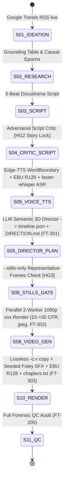

# 📜 01_CONTRACTS.md - KHẾ ƯỚC DỮ LIỆU VIDEO FACTORY (SSOT)

> **NGUỒN SỰ THẬT DUY NHẤT CHO PIPELINE S1–S11 & VOICE-FIRST PAPERTRAILS 3D ENGINE.**
> Tuân thủ Hiến pháp R118 (Zero-Mock), R120/R135 (Real Word Timestamps), R128 (Generic Contract), R132 (Decoupled Engine), R136 (Pure Beat Header) và R140 (Kinetic Vitality).

---

## 1. STATE MACHINE PIPELINE CHUẨN (CANONICAL VOICE-FIRST PAPERTRAILS 2.0)



---

## 2. PYDANTIC SCHEMAS CHUẨN TẮC

```python
from pydantic import BaseModel, Field
from typing import List, Optional, Dict, Any

# ==============================================================================
# [FT-301] PAPERTRAILS 3D TIMELINE SCHEMA (CANONICAL V1 - 35+1 PROPS - SSOT)
# ==============================================================================
class PapertrailsCaptionWord(BaseModel):
    """Mốc từ vựng đo thực tế từ faster-whisper / WordBoundary (0ms drift)."""
    word: str = Field(..., description="Từ đơn thực tế")
    start: float = Field(..., ge=0.0, description="Thời điểm bắt đầu (giây)")
    end: float = Field(..., ge=0.0, description="Thời điểm kết thúc (giây)")


class PapertrailsCaption(BaseModel):
    """Dải phụ đề giấy rách torn-paper tối đa ~3.5s / <= 8 từ."""
    start: float = Field(..., ge=0.0)
    end: float = Field(..., ge=0.0)
    text: str = Field(...)
    words: Optional[List[PapertrailsCaptionWord]] = Field(default=None)


class PapertrailsSceneCard(BaseModel):
    """Thẻ bằng chứng dán đè trên thế giới 3D (note hoặc photo)."""
    kind: str = Field(..., pattern=r"^(note|photo)$")
    head: Optional[str] = Field(default=None)
    lines: Optional[List[str]] = Field(default=None)
    numbered: Optional[bool] = Field(default=True)
    side: str = Field(default="right", pattern=r"^(left|right|center)$")
    big: Optional[bool] = Field(default=False)
    lineAt: Optional[List[float]] = Field(default=None)
    img: Optional[str] = Field(default=None)
    aspect: Optional[float] = Field(default=0.5625)
    hl: Optional[List[float]] = Field(default=None)
    hlAt: Optional[float] = Field(default=0.9)
    badge: Optional[str] = Field(default=None)
    badgeAt: Optional[float] = Field(default=None)
    caption: Optional[str] = Field(default=None)


class PapertrailsScene(BaseModel):
    """Phân cảnh 3D Pop-Up Book nhịp 2.0s-5.0s neo theo mốc từ thật."""
    id: str = Field(..., pattern=r"^shot-\d{3}$")
    start: float = Field(..., ge=0.0)
    end: float = Field(..., ge=0.0)
    narration: str = Field(...)
    title: str = Field(..., description="Tiêu đề 2-5 từ sạch sẽ (cấm rò mã nội bộ Rule 136)")
    biome: str = Field(..., pattern=r"^(heartland|desert|snow|blossom|pinewood)$")
    night: bool = Field(default=False)
    action: str = Field(default="reveal", pattern=r"^(walk|idle|reveal|celebrate|grow)$")
    prop: str = Field(
        default="ledger",
        pattern=(
            r"^(none|village|forest|bridge|mountain|sun|moon|house|tree|book|coin|chart|"
            r"factory|clock|people|water|globe|voice-note|edit-board|pop-up|film|bubble|mic|"
            r"courthouse|gavel|ledger|container|vault|scale|contract|megaphone|briefcase|shield|"
            r"hanko-stamp|brass-caliper|forensic-loupe)$"
        ),
    )
    camera: str = Field(default="push", pattern=r"^(push|orbit|crane|low|wide|close|top)$")
    color: str = Field(default="#d79a45", pattern=r"^#[0-9a-fA-F]{6}$")
    visual: str = Field(..., description="Ghi chú đạo diễn: subject -> action -> consequence")
    timing: Optional[Dict[str, Any]] = Field(default=None, description="Contact-Frame Timing Sheet (±2f)")
    card: Optional[PapertrailsSceneCard] = Field(default=None)


class PapertrailsTimelineSpec(BaseModel):
    """Khế ước Single Source of Truth giữa S05, S08, S10 và S11."""
    version: int = Field(default=1)
    stageMode: str = Field(default="forensic_desk", pattern=r"^(forensic_desk|storybook)$")
    width: int = Field(default=1920)
    height: int = Field(default=1080)
    fps: int = Field(default=30)
    seed: int = Field(default=42)
    duration: float = Field(..., gt=0.0)
    audio: str = Field(...)
    captions: List[PapertrailsCaption] = Field(..., min_length=1)
    scenes: List[PapertrailsScene] = Field(..., min_length=1)
    timing: Dict[str, Any] = Field(default_factory=dict)
    direction: Dict[str, Any] = Field(default_factory=dict)
```

---

## 3. QUARANTINED LEGACY SCHEMAS (CHỈ PHỤC VỤ HERMETIC `e2e_min` BACKWARD COMPAT)

- `MasterSheetAssetBundle` (`FT-201`), `OmniTactilePlate` (`FT-203`), `RemotionSceneProp` (`FT-204`), `DynamicMasterArtManifest` (`FT-206`), `ContinuousDeskWorldProps` (`FT-207`) không còn được kích hoạt trong luồng `prod` sau HG2.
