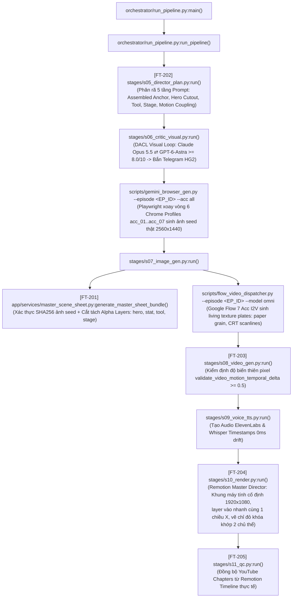

# 🔌 03_WIRING.md - SƠ ĐỒ ĐẤU NỐI PIPELINE (ANTI-ORPHAN CODE)

> **CHỐNG BỎ QUÊN TÍNH NĂNG & DỊCH VỤ MỒ CÔI.**
> Mọi stage code và service bắt buộc phải được gọi bởi orchestrator chính `orchestrator/run_pipeline.py`.
> Bất kỳ hàm nào không có caller hợp lệ sẽ bị `harness_guard.py check` đánh trượt ngay lập tức.

---

## 1. MA TRẬN ĐẤU NỐI THỰC THI (CALLER WIRING MATRIX)

| Feature ID | Service / Hàm | File Code | Caller File (Nơi gọi) | Vị trí / Điều kiện kích hoạt | Lệnh CLI Thực Thi Đích Danh |
| :--- | :--- | :--- | :--- | :--- | :--- |
| `[FT-201]` | `generate_master_sheet_bundle` | `app/services/master_scene_sheet.py` | `stages/s07_image_gen.py` | Kích hoạt trong Stage S07 khi sinh tài sản thị giác phân cảnh | `python -m orchestrator.run_pipeline --only s07_image_gen` |
| `[FT-202]` | `run` | `stages/s05_director_plan.py` | `orchestrator/run_pipeline.py` | Kích hoạt tại Stage S05 sau khi kịch bản được phê duyệt | `python -m orchestrator.run_pipeline --only s05_director_plan` |
| `[FT-203]` | `run` | `stages/s08_video_gen.py` | `orchestrator/run_pipeline.py` | Kích hoạt tại Stage S08 để sinh các plate chất liệu xúc giác từ Omni | `python -m orchestrator.run_pipeline --only s08_video_gen` |
| `[FT-204]` | `run` | `stages/s10_render.py` | `orchestrator/run_pipeline.py` | Kích hoạt tại Stage S10 để kết xuất video tổng thành Remotion | `python -m orchestrator.run_pipeline --only s10_render` |
| `[FT-205]` | `run` | `stages/s11_qc.py` | `orchestrator/run_pipeline.py` | Kích hoạt tại Stage S11 để kiểm toán chất lượng và đồng bộ Chapter | `python -m orchestrator.run_pipeline --only s11_qc` |
| `[FT-206]` | `assign_scene_layout_blueprint` | `app/services/scene_layout_director.py` | `stages/s05_director_plan.py` | Kích hoạt tại S05/S10 để gán bố cục không gian bất đối xứng và topology dây nối riêng biệt | `python -m pytest tests/test_dynamic_layout_archetypes.py -v` |
| `[FT-207]` | `build_continuous_desk_world` | `app/services/desk_world_director.py` | `stages/s10_render.py` | Kích hoạt tại Stage S10 để kết xuất video hành trình camera qua bàn điều tra liên tục DeskWorld | `python -m pytest tests/test_desk_world_director.py -v` |

---

## 2. CALL-CHAIN FLOWCHART TỔNG THỂ & HẠ TẦNG BROWSER FLEET

