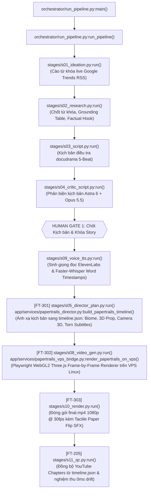

# 🔌 03_WIRING.md - SƠ ĐỒ ĐẤU NỐI PIPELINE (ANTI-ORPHAN CODE)

> **CHỐNG BỎ QUÊN TÍNH NĂNG & DỊCH VỤ MỒ CÔI.**
> Mọi stage code và service bắt buộc phải được gọi bởi orchestrator chính `orchestrator/run_pipeline.py`.
> Bất kỳ hàm nào không có caller hợp lệ sẽ bị `harness_guard.py check` đánh trượt ngay lập tức.

---

## 1. MA TRẬN ĐẤU NỐI THỰC THI (CALLER WIRING MATRIX)

| Feature ID | Service / Hàm | File Code | Caller File (Nơi gọi) | Vị trí / Điều kiện kích hoạt | Lệnh CLI Thực Thi Đích Danh |
| :--- | :--- | :--- | :--- | :--- | :--- |
| `[FT-301]` | `build_papertrails_timeline` | `app/services/papertrails_director.py` | `stages/s05_director_plan.py` | Kích hoạt tại S05 sau khi chốt kịch bản tại HG1 và có giọng đọc S09 | `python -m orchestrator.run_pipeline --only s05_director_plan` |
| `[FT-302]` | `render_papertrails_on_vps` | `app/services/papertrails_vps_bridge.py` | `stages/s08_video_gen.py` | Kích hoạt tại S08 để render Playwright WebGL2 Three.js frame-by-frame trên VPS | `python -m orchestrator.run_pipeline --only s08_video_gen` |
| `[FT-303]` | `run` | `stages/s10_render.py` | `orchestrator/run_pipeline.py` | Kích hoạt tại S10 để đóng gói master video MP4 và xuất bản phẩm | `python -m orchestrator.run_pipeline --only s10_render` |
| `[FT-205]` | `run` | `stages/s11_qc.py` | `orchestrator/run_pipeline.py` | Kích hoạt tại S11 để kiểm toán chất lượng và đồng bộ Chapter từ timeline.json | `python -m orchestrator.run_pipeline --only s11_qc` |

---

## 2. CALL-CHAIN FLOWCHART TỔNG THỂ (CANONICAL 2.0 PAPERTRAILS)

