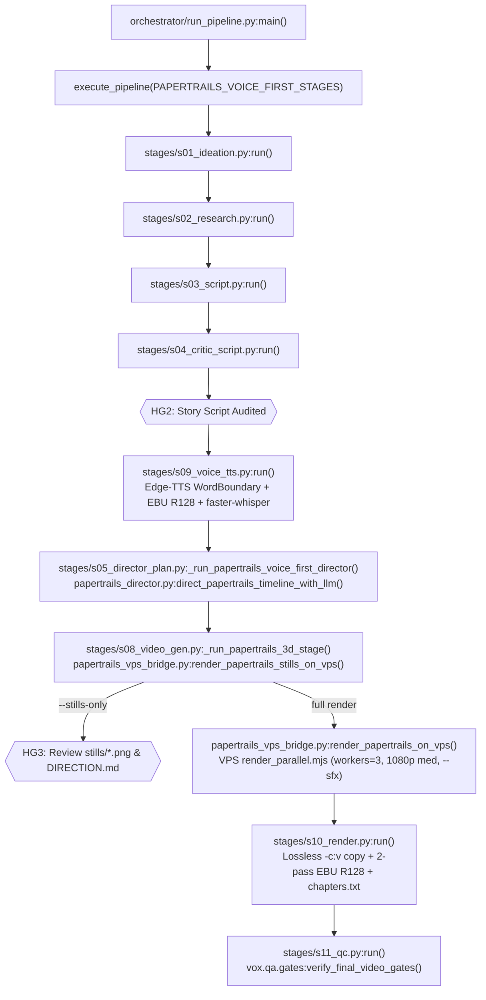

# 🔌 03_WIRING.md - SƠ ĐỒ ĐẤU NỐI PIPELINE (ANTI-ORPHAN CODE)

> **CHỐNG BỎ QUÊN TÍNH NĂNG & DỊCH VỤ MỒ CÔI.**
> Mọi stage và service đều được điều phối trực tiếp qua `orchestrator/run_pipeline.py` theo danh sách `PAPERTRAILS_VOICE_FIRST_STAGES` trong chế độ `prod`.

---

## 1. MA TRẬN ĐẤU NỐI THỰC THI (CALLER WIRING MATRIX)

| Feature ID | Service / Hàm | File Code | Caller File | Điều kiện kích hoạt | Lệnh CLI Thực Thi |
| :--- | :--- | :--- | :--- | :--- | :--- |
| `[FT-303]` | `_synthesize_edge_tts_stream`, `_measure_words_with_faster_whisper`, `normalize_audio_ebur128` | `stages/s09_voice_tts.py`, `vox/ffmpeg_utils.py` | `orchestrator/run_pipeline.py` | Stage 5 trong `PAPERTRAILS_VOICE_FIRST_STAGES` (sau HG2) | `python -m orchestrator.run_pipeline --only s09_voice_tts` |
| `[FT-301]` | `direct_papertrails_timeline_with_llm` | `app/services/papertrails_director.py` | `stages/s05_director_plan.py` | Chế độ `prod` live (sau S09) | `python -m orchestrator.run_pipeline --only s05_director_plan` |
| `[FT-302]` | `render_papertrails_stills_on_vps` | `app/services/papertrails_vps_bridge.py` | `stages/s08_video_gen.py` | Luôn chạy trước render; dừng tại HG3 nếu có `--stills-only` | `python -m orchestrator.run_pipeline --only s08_video_gen --stills-only` |
| `[FT-302]` | `render_papertrails_on_vps` (`parallel_workers=2`, `quality=vox`, `render_fps=15`, `jpeg`) | `app/services/papertrails_vps_bridge.py` | `stages/s08_video_gen.py` | Chạy `render_parallel.mjs` trên VPS khi không bật `--stills-only` | `python -m orchestrator.run_pipeline --only s08_video_gen` |
| `[FT-303]` | `_validate_and_assemble_video` + `mix_papertrails_foley_sfx` (`-c:v copy` + 2-pass `loudnorm`) | `stages/s10_render.py`, `vox/ffmpeg_utils.py` | `orchestrator/run_pipeline.py` | Phát hiện `master_papertrails.mp4` > 1KB | `python -m orchestrator.run_pipeline --only s10_render` |
| `[FT-205]` | `verify_final_video_gates` + `audit_papertrails_timeline_antipatterns` | `vox/qa/gates.py`, `app/services/papertrails_director.py` | `stages/s11_qc.py` | Kiểm toán thành phẩm cuối cùng & timeline | `python -m orchestrator.run_pipeline --only s11_qc` |

---

## 2. CALL-CHAIN FLOWCHART TỔNG THỂ (VOICE-FIRST PAPERTRAILS 2.0)

