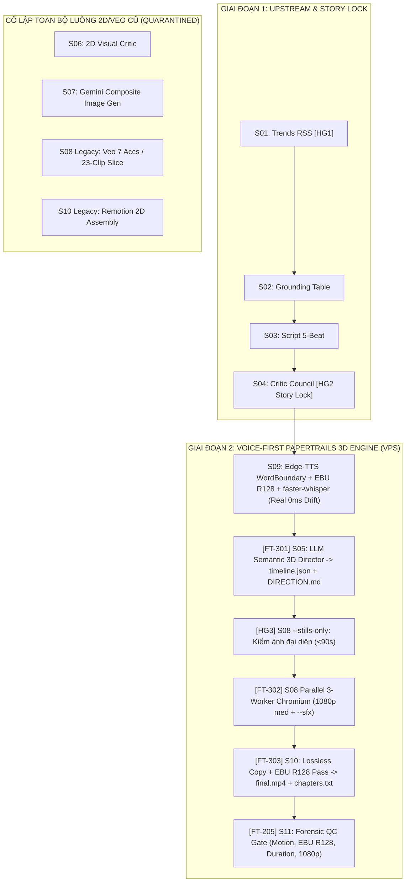

# 🎬 AI VIDEO FACTORY HARNESS - SINGLE SOURCE OF TRUTH (SSOT)

> **QUY CHUẨN ĐẶC TẢ SẢN XUẤT VIDEO TỰ ĐỘNG (CANONICAL PIPELINE 2.0 & VOICE-FIRST PAPERTRAILS 3D ENGINE)**
> Ràng buộc 100% Agent/Subagent. Áp dụng cơ chế **Cập nhật Trực Tiếp (In-Place Living State)**.
> Tuyệt đối cấm tạo các file changelog hay ghi log song song gây nhiễu loạn giữa trạng thái cũ và mới.

---

## 🏛️ I. QUYẾT ĐỊNH KIẾN TRÚC TỐI THƯỢNG (EXECUTIVE ARCHITECTURAL MANDATE)

Hệ thống chính thức đóng băng kiến trúc sản xuất **Voice-First Papertrails 3D**:
1. **Giai đoạn Tiền kỳ (Upstream - Trước & Tại Human Gate 2)**:
   - **S01 Ideation**: Cào từ khóa nóng thời gian thực (Google Trends RSS live) [HG1].
   - **S02 Research**: Đào sâu bối cảnh, trích xuất Grounding Table lượng hóa.
   - **S03 Script**: Viết kịch bản docudrama điều tra 5-Beat.
   - **S04 Critic**: Hội đồng phản biện (Astra + Opus) thẩm định kịch bản $\rightarrow$ **Chốt Story tại Human Gate 2**.

2. **Giai đoạn Hậu kỳ Voice-First (Downstream - Sau Chốt Story)**:
   - Toàn bộ cơ chế 2D/Veo cũ (**S05 legacy image/Veo prompts**, **S06 2D visual critic**, **S07 Gemini image gen**, **S08 Veo/23-clip reslicing**, **S10 Remotion**) chính thức **CÔ LẬP HOÀN TOÀN (`QUARANTINED_LEGACY`)** trong luồng `prod` (chỉ giữ helper tương thích ngược cho `e2e_min` unit tests).
   - Luồng chuẩn duy nhất cho `prod`:
     1. **S09 Voice & Real ASR**: Edge-TTS (`boundary="WordBoundary"`) + chuẩn hóa âm lượng hai bước EBU R128 (`-16.0 LUFS`, `TP <= -2.5 dBTP`) + đo mốc từ thực tế qua `faster-whisper` (Local hoặc VPS). Cấm chia đều giả lập theo độ dài chữ ở chế độ `prod`.
     2. **S05 `[FT-301]` LLM Semantic 3D Director**: Đọc trọn lời thoại gắn mốc từ thực tế + S02 Grounding Table, cắt shot nhịp `2.0s–5.0s` trên ranh giới từ/mệnh đề thật, gán 32 Paper Props + 5 Biomes + Camera động học (`push|orbit|crane|low`) + Evidence Note Cards + tiêu đề sạch theo Rule 136, xuất `timeline.json` (`1920x1080`) và `DIRECTION.md`.
     3. **S08 `[FT-302]` Pre-Render Stills Gate (`--stills-only`) & Parallel 3D Render**: Kết xuất ~12 khung hình mẫu nhanh (`--stills-only`) tại HG3 để kiểm định thị giác, sau đó kết xuất song song 3 worker Chromium (`render_parallel.mjs`, `1920x1080 --quality med`, `--sfx`, `env -u NODE_CHANNEL_FD ...`) tạo `master_papertrails.mp4`.
     4. **S10 `[FT-303]` Lossless Master & Chapters**: Stream-copy video (`-c:v copy`) + hai bước EBU R128 trên audio sau trộn SFX $\rightarrow$ `10_render/final.mp4` + `chapters.txt`.
     5. **S11 `[FT-205]` QC Gate**: Kiểm toán codec, độ phân giải, thời lượng, khung hình đen, độ sống động chuyển động (Rule 140) và chuẩn EBU R128.

---

## 🗺️ II. BẢN ĐỒ CẤU TRÚC THƯ MỤC `.harness/`

| File | Trách nhiệm duy nhất trong Video Factory |
| :--- | :--- |
| `01_CONTRACTS.md` | Khế ước dữ liệu cứng: `PapertrailsTimelineSpec` (32 props, kinetic cameras), `PapertrailsSceneCard`, State Machine Voice-First. |
| `02_FEATURES.md` | Danh mục tính năng sống `[FT-301]`, `[FT-302]`, `[FT-303]`, `[FT-205]` và đánh dấu cô lập `[FT-201..207]` legacy. |
| `03_WIRING.md` | Bản đồ đấu nối thực thi trong `orchestrator/run_pipeline.py` (`PAPERTRAILS_VOICE_FIRST_STAGES`). |
| `04_VERIFICATION.md` | Ma trận kiểm thử tất định (unit tests, AST Rule 139, Ghost Scan, Semantic Bias, Live Trial). |
