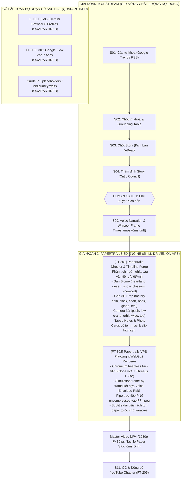

# 🎬 AI VIDEO FACTORY HARNESS - SINGLE SOURCE OF TRUTH (SSOT)

> **QUY CHUẨN ĐẶC TẢ SẢN XUẤT VIDEO TỰ ĐỘNG (CANONICAL PIPELINE 2.0 & PAPERTRAILS 3D ENGINE)**
> Ràng buộc 100% Agent/Subagent. Áp dụng cơ chế **Cập nhật Trực Tiếp (In-Place Living State)**.
> Tuyệt đối cấm tạo các file changelog hay ghi log song song gây nhiễu loạn giữa trạng thái cũ và mới.

---

## 🏛️ I. QUYẾT ĐỊNH KIẾN TRÚC TỐI THƯỢNG (EXECUTIVE ARCHITECTURAL MANDATE)

Hệ thống chính thức đóng băng kiến trúc sản xuất toàn diện:
1. **Giai đoạn Tiền kỳ (Upstream - Trước & Tại Human Gate 1)**:
   - **S01 Ideation**: Cào từ khóa nóng thời gian thực (Google Trends RSS live).
   - **S02 Research**: Đào sâu bối cảnh, trích xuất Grounding Table lượng hóa.
   - **S03 Script**: Viết kịch bản docudrama điều tra 5-Beat.
   - **S04 Critic**: Hội đồng phản biện (Astra + Opus) thẩm định kịch bản $\rightarrow$ **Chốt kịch bản tại Human Gate 1**.
   - **S09 Voice & Audio Sync**: Sinh giọng đọc và trích xuất Whisper word-level timestamps (frame đọc, 0ms drift).

2. **Giai đoạn Hậu kỳ (Downstream - Sau Human Gate 1: CÔ LẬP TOÀN BỘ MÃ CŨ & CHUYỂN GIAO SANG PAPERTRAILS 3D ENGINE)**:
   - Toàn bộ cơ chế cũ (FLEET_IMG chờ ảnh vẽ, Google Flow Veo 3.1 7 tài khoản, crude PIL boxes) chính thức bị **CÔ LẬP VÀO QUARANTINE**.
   - **Papertrails 3D Engine (Loc Studio Papertrails v0.2.1 lite - Upstream git: https://github.com/xikhar/papertrails)** trở thành động cơ sản xuất video duy nhất:
     + Chuyển thể trực tiếp kịch bản và frame đọc thành `timeline.json` (Biomes, 3D Props, Camera 3D, Torn-paper captions, Paper cards).
     + Render WebGL2 Three.js frame-by-frame trên VPS Linux bằng Playwright headless, kết xuất trực tiếp MP4 master 1080p 16:9 với độ trôi lệch âm thanh 0ms drift và hiệu ứng lật giấy xúc giác `--sfx`.

---

## 🗺️ II. BẢN ĐỒ CẤU TRÚC THƯ MỤC `.harness/`

| File | Trách nhiệm duy nhất trong Video Factory |
| :--- | :--- |
| `01_CONTRACTS.md` | Khế ước dữ liệu cứng: `PapertrailsTimelineSpec`, `SceneSubDirectorPlan`, `WhisperCaptionWord`. Cấm hoàn toàn `None` hoặc trường rỗng. |
| `02_FEATURES.md` | Danh mục tính năng sống `[FT-301]` $\to$ `[FT-303]` (mới) và đánh dấu cô lập `[FT-201]`, `[FT-203]`. In-place update. |
| `03_WIRING.md` | Bản đồ đấu nối: `orchestrator/run_pipeline.py` gọi service nào, truyền props nào. Triệt tiêu 100% mã mồ côi (Ghost Code). |
| `04_VERIFICATION.md` | Ma trận kiểm thử tất định: Lệnh CLI thực tế trên VPS/Local, tiêu chuẩn Gherkin PASS/FAIL, bằng chứng runtime sống. |
