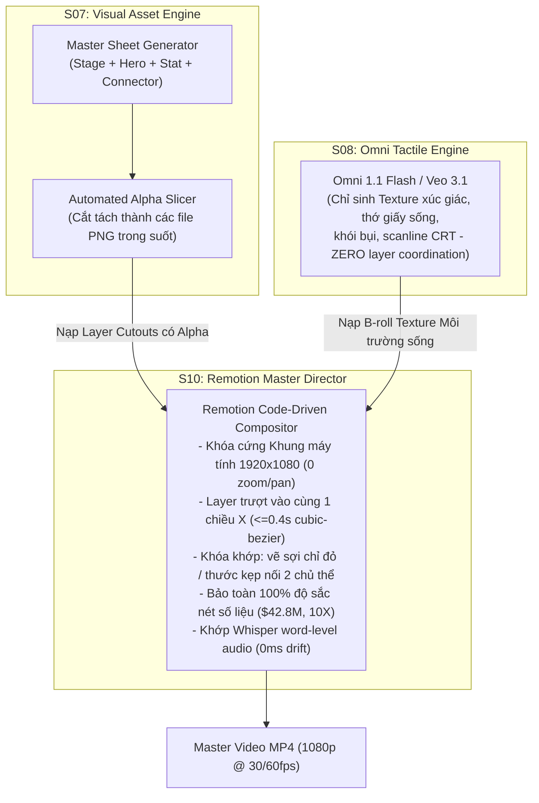

# 🎬 AI VIDEO FACTORY HARNESS - SINGLE SOURCE OF TRUTH (SSOT)

> **QUY CHUẨN ĐẶC TẢ SẢN XUẤT VIDEO TỰ ĐỘNG (CANONICAL PIPELINE 2.0 & VOX ENGINE V3)**
> Ràng buộc 100% Agent/Subagent. Áp dụng cơ chế **Cập nhật Trực Tiếp (In-Place Living State)**.
> Tuyệt đối cấm tạo các file changelog hay ghi log song song gây nhiễu loạn giữa trạng thái cũ và mới.

---

## 🏛️ I. QUYẾT ĐỊNH KIẾN TRÚC TỐI THƯỢNG (EXECUTIVE ARCHITECTURAL MANDATE)

Dựa trên kết quả thực nghiệm đa phân cảnh (Multi-Scene Benchmark S1: The Breach $\to$ S2: The Multiplier), hệ thống chính thức đóng băng kiến trúc sản xuất theo **Mô Hình Lai Hướng A+ (Hybrid Vox Architecture)**:

### 1. Phân Định Rạch Ròi Trách Nhiệm (Separation of Concerns)
1. **Remotion (Direction A) = Đạo Diễn Khung Hình (Master Director)**:
   - Sở hữu $100\%$ quyền điều phối không gian và thời gian: Viewport khung máy tính cố định, layer trượt vào tốc độ cao cùng chiều, quán tính dừng khựng (dead-stop spatial hold), vẽ vector chỉ đỏ nối các chủ thể, đồng bộ phụ đề Whisper.
2. **Omni (Direction B) = Động Cơ Chất Liệu Xúc Giác (Tactile Texture Engine)**:
   - Được giải phóng hoàn toàn khỏi nhiệm vụ điều phối layer, định vị vật thể và vẽ số liệu.
   - Chỉ nhận prompt sinh background/plate môi trường sống: thớ giấy ngả vàng vi rung 12fps, màn hình CRT scanlines, bề mặt tài liệu lưu trữ cổ.
3. **Master Sheet = Bộ Linh Kiện Nhà Máy (Factory Component Kit)**:
   - Cung cấp điểm neo thẩm mỹ thống nhất xuyên suốt mọi phân cảnh.
   - Tự động bóc tách thành các layer độc lập, triệt tiêu hoàn toàn căn bệnh "đưa ảnh phẳng composite vào model video rồi cầu may".

---

## 🗺️ II. BẢN ĐỒ CẤU TRÚC THƯ MỤC `.harness/`

| File | Trách nhiệm duy nhất trong Video Factory |
| :--- | :--- |
| `01_CONTRACTS.md` | Khế ước dữ liệu cứng: `MasterSheetAssetBundle`, `OmniTactilePlate`, `RemotionSceneProps`, `EpisodeContext`. Cấm hoàn toàn `None` hoặc trường rỗng. |
| `02_FEATURES.md` | Danh mục tính năng sống `[FT-201]` $\to$ `[FT-205]`. File luôn phản ánh trạng thái thực tế hiện tại, không ghi nhật ký chắp vá. |
| `03_WIRING.md` | Bản đồ đấu nối: `orchestrator/run_pipeline.py` gọi hàm nào, truyền props nào. Triệt tiêu 100% mã mồ côi (Ghost Code). |
| `04_VERIFICATION.md` | Ma trận kiểm thử tất định: Lệnh CLI thực tế, tiêu chuẩn Gherkin PASS/FAIL, bằng chứng runtime sống. |
