# 🔄 END-TO-END EXECUTION FLOW & STATE MACHINE DIAGRAM (AVF-E2E-002)

> **Audit Date**: 2026-10-17  
> **Auditor**: Worker Gemini 3.8 Flash High (Antigravity IDE) under Boss Claude Opus 5.5 Supervision  
> **Scope**: Complete E2E AI Video Factory Architecture (Automated + Human-in-the-Loop Gates)

---

## 1. Master Pipeline State Machine Diagram (Mermaid)

```mermaid
flowchart TD
    subgraph PHASE_1 ["Phase 1: Market Recon & Viability Gate"]
        B1_CRON["VPS Cron Daily 23:00 UTC<br/>(run_trend_pipeline.py)"] --> B1_LOCK["Daily Market Quota Guard<br/>(is_market_done_today)"]
        B1_LOCK -- "Already Produced / Exhausted" --> SKIP_DAY["Skip Crawl & Log (0 Token)"]
        B1_LOCK -- "Open" --> B1_RECON["B1 Trend Hunter<br/>Google Trends RSS + YouTube Recon"]
        B1_RECON --> B15_GAP["B1.5 Blue Ocean Gap<br/>& Competitor Recon"]
        B15_GAP --> B15_GROUND["B1.5 Fact Grounding Table<br/>(grounding_intel.json)"]
        B15_GROUND --> HG1["📢 HUMAN GATE 1<br/>Informative Telegram Broadcast<br/>(0 Buttons / Non-Blocking)"]
    end

    subgraph PHASE_2 ["Phase 2: Narrative & Audio Spine"]
        HG1 --> B2_STORY["B2 Story Engine<br/>5-Beat Docudrama Script"]
        B2_STORY --> B2_GATE{"Story Gate<br/>12/12 & DNA Score"}
        B2_GATE -- "< 7.0 / Fail" --> B2_REPAIR["B2 Self-Repair / Next Candidate<br/>(Max 2 attempts)"]
        B2_REPAIR --> B2_STORY
        B2_GATE -- ">= 7.0 Pass" --> B26_TTS["B2.6 / S09 Voice Engine<br/>Edge-TTS (48kHz Mono)"]
        B26_TTS --> B26_WHISPER["Whisper Word Alignment<br/>(spoken_sentences.json & subtitles.ass)"]
    end

    subgraph PHASE_3 ["Phase 3: Visual Director & Prompt Forge"]
        B26_WHISPER --> B3_DIRECTOR["B3 / S05 Dynamic Director Plan<br/>2-Layer Layout: 16:9 BG + 1:1 FG"]
        B3_DIRECTOR --> B35_FORGE["B3.5 Prompt Forge<br/>(prompts_forge.json & bulk_prompts.txt)"]
        B35_FORGE --> B35_AUDIT{"Visual Convergence<br/>Audit (Score >= 8.0?)"}
        B35_AUDIT -- "Converged >= 8.0" --> HG2["🎨 HUMAN GATE 2<br/>Telegram Card Dispatched<br/>(prompts_forge_watcher.py)"]
        B35_AUDIT -- "Not Converged" --> B35_FIX["Block HG2 & Log Error"]
    end

    subgraph PHASE_4 ["Phase 4: Antigravity Local Generation (Zero API Cost)"]
        HG2 --> AG_RUN["User runs in Antigravity IDE:<br/>/vf-image-gen /run:image --episode EP_ID"]
        AG_RUN --> AG_BROWSER["Playwright Gemini Web Pool<br/>(7 Chrome Profiles Rotation)"]
        AG_BROWSER --> B5_CHROMA["B5 Pure PIL Chroma Keyer<br/>(#FF00FF Magenta Cutout -> 1:1 PNG)"]
        B5_CHROMA --> AG_PUSH["Push Images to VPS / Notion<br/>(images_ready.json written)"]
    end

    subgraph PHASE_5 ["Phase 5: Event-Driven Post-Production & Render"]
        AG_PUSH --> INOTIFY["VPS inotify File Watcher<br/>(image_ready_watcher.py)"]
        INOTIFY --> CONT_RUN["Spawns continue_after_images.py"]
        CONT_RUN --> B6_PROPS["B6.1 Remotion Props Staging<br/>(build_remotion_props.py)"]
        B6_PROPS --> B62_GATE["B6.2 Adversarial Director Gate"]
        B62_GATE --> B7_RENDER["B7 / S10 Master Remotion Render<br/>CPU Concat & 2-Pass Loudnorm (-14 LUFS)"]
        B7_RENDER --> B9_SWEEP["B9 Post-Render Technical Sweep<br/>Rule 135 Exact YouTube Chapters"]
    end

    subgraph PHASE_6 ["Phase 6: YouTube Staging & Final Human Approval"]
        B9_SWEEP --> B10_UPLOAD["B10 Upload Engine<br/>(execute_b10_auto_seo_upload_gate2.py)"]
        B10_UPLOAD --> YT_UNLISTED["Upload to YouTube: UNLISTED<br/>Altered/Synthetic Media: YES"]
        YT_UNLISTED --> HG3["👑 HUMAN GATE 3<br/>Telegram Review Card<br/>(Open Studio, Watch Unlisted, Public Button)"]
        HG3 --> USER_CLICK{"User Click"}
        USER_CLICK -- "Public Button" --> YT_PUBLIC["YouTube Video -> PUBLIC"]
    end

    subgraph PHASE_7 ["Phase 7: Post-Mortem Feedback Loop"]
        YT_PUBLIC --> B11_CRON["VPS Cron Every 6h<br/>(scripts/b11_engine.py)"]
        B11_CRON --> B11_48H["Post-Mortem 48h Retention Probe<br/>Tier 1 Delta Scan (0 token if no change)"]
        B11_48H --> B11_VAULT["Sync Insights to Notion Memory Vault<br/>Feeds B2 Story Instincts"]
    end
```

---

## 2. Transition Contracts & Handoff Signatures

| Transition | Primary Source File | Trigger Condition | Artifact Produced | Handled By / Consumer |
| :--- | :--- | :--- | :--- | :--- |
| **B1 ➔ B1.5** | `app/services/trend_engine_b1.py` | Google RSS / YouTube trends found | `grounding_intel.json` | `competitor_recon_b15.py` |
| **B1.5 ➔ B2** | `app/services/trend_engine_b1.py` | Viability score >= 8.0 | `HG1 Telegram Broadcast` | `story_engine_b2.py` |
| **B2 ➔ B3** | `app/services/story_engine_b2.py` | Story Gate 12/12 & DNA >= 7.0 | `story.txt`, `spoken_sentences.json` | `vox_automated_director.py` |
| **B3 ➔ B3.5** | `app/services/vox_automated_director.py` | Audio length + 2-shot beats ready | `prompts_forge.json`, `visual_convergence_audit.json` | `prompts_forge_watcher.py` |
| **B3.5 ➔ B4** | `scripts/watchers/prompts_forge_watcher.py` | Score >= 8.0 & converged: true | `Human Gate 2 Telegram Card` | Antigravity User (`vf-image-gen`) |
| **B4/B5 ➔ B6** | Antigravity Playwright 7-Account Pool | All 26/26 images approved & cut | `images_ready.json` | `scripts/watchers/image_ready_watcher.py` |
| **B6 ➔ B7** | `scripts/continue_after_images.py` | `images_ready.json` valid | `remotion_props.json` | `resume_episode.py` / `assemble.py` |
| **B7 ➔ B9** | Remotion / FFmpeg loudnorm | `final_169.mp4` > 10MB | `final_169.mp4` (-14 LUFS) | `post_render_technical_sweep.py` |
| **B9 ➔ B10** | `post_render_technical_sweep.py` | Chapter count >= 3, starts 00:00 | `seo_package.json` | `execute_b10_auto_seo_upload_gate2.py` |
| **B10 ➔ HG3** | YouTube Data API v3 | Upload HTTP 200 (Unlisted) | `Human Gate 3 Telegram Card` | User 1-click Public confirmation |
| **HG3 ➔ B11** | YouTube Studio / Telegram Callback | Video live for 48 hours | `channel_analytics_<mkt>.json` | `scripts/b11_engine.py` |
