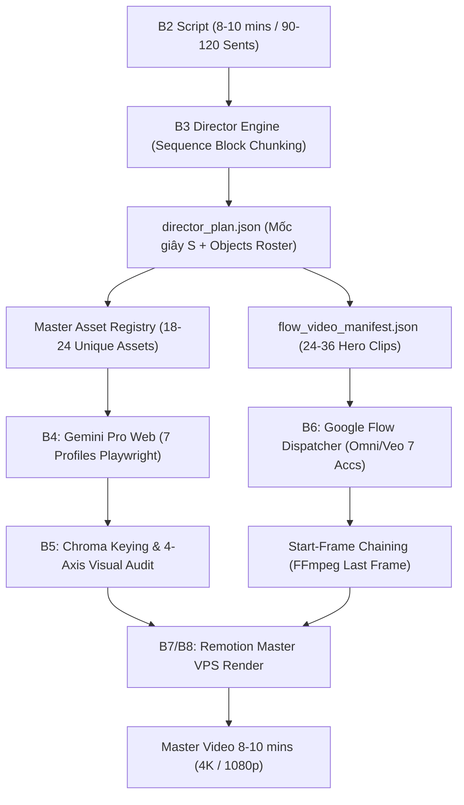

# 🗺️ VOX STUDIO UPGRADE ROADMAP (8–10 MINUTE INVESTIGATIVE DOCUDRAMA)

> **MỤC TIÊU CỐT LÕI**: Nâng cấp toàn diện bộ máy Director (B3), Master Asset Registry (B4), và Video Kinematics & Dispatcher (B6) cho định dạng phim tài liệu điều tra chuyên sâu Vox dài **8–10 phút** (~480–600 giây, 90–120 scenes, 5 Hồi/Acts).
> Tích hợp 7 Chạm Studio (Mệnh lệnh cơ học, Phân rã mốc giây $S$ đa vật thể, Khóa 1 lệnh camera, Asset Registry 18–24 items, Start-Frame Chaining FFmpeg) trên 100% hạ tầng hiện có.

---

## ⚖️ I. NGUYÊN TẮC BẤT BIẾN (IRON LAWS & BOUNDARIES)

1. **Định dạng bảo toàn 100% (Rule 128)**:
   - Video là **Phóng sự điều tra chuyên sâu 8–10 phút** (480s - 600s, 90–120 scenes, 5 Acts: Catalyst, Hidden Mechanism, Paper Trail, Smoking Gun, Modern Mirror).
   - **CẤM TUYỆT ĐỐI** chuyển sang làm video ngắn hoặc truyện AI viễn tưởng.
2. **Hạ tầng hiện hữu (Rule 119)**:
   - Sinh ảnh B4: Gemini Pro Web Playwright qua 7 Google Chrome profiles.
   - Sinh video B6: Google Flow Web UI qua 7 Google AI Pro accounts (Omni 1.1 Flash / Veo 3.1).
   - Hậu kỳ & Render B7/B8: Remotion CPU trên VPS Debian (`/root/video_factory`).
3. **Mã nguồn sạch & Decoupled Engine (Rule 128 & 132)**:
   - Không hardcode prompt, không hardcode tên tập/nhân vật trong code `.py`.
   - Toàn bộ prompt nghiệp vụ quản trị tại `config/prompts/` và Notion SoT.
4. **Không dữ liệu ảo (Rule 118, 121, 127)**:
   - Zero-Mock Data trong production runtime. Kiểm chứng có bằng chứng pháp y thực tế (file size, sha256, duration).

---

## 📐 II. 4 TRỤ CỘT KIẾN TRÚC KỸ THUẬT (ARCHITECTURAL PILLARS)



### 1. Sequence Block Chunking (Khắc phục giới hạn Token LLM)
- **Vấn đề**: Kịch bản 8–10 phút có 90–120 câu thoại. Nếu sinh toàn bộ schema chi tiết trong 1 lần gọi, payload đạt 15.000–18.000 tokens, dễ đứt đuôi JSON hoặc timeout.
- **Giải pháp**: Chia timeline thành **10–14 Thematic Sequence Blocks** (mỗi Block gồm 6–8 scenes, 24–48 giây, ~1.200 tokens output).
- **Liên tục thị giác**: Truyền `visual_continuity_link_to_next` giữa Block $N$ và Block $N+1$ để neo vật thể trên bàn làm việc không bị biến mất.

### 2. Master Asset Registry Khống Chế Trần 18–24 Unique Assets
- **Vấn đề**: Tránh bùng nổ 200–300 assets ngẫu nhiên gây cạn kiệt quota 7 profile Chrome.
- **Giải pháp**: Giới hạn cố định **18–24 Unique Assets** cho toàn bộ 8–10 phút:
  - 02 Chân dung nhân vật chính (Halftone B&W cắt viền trắng).
  - 04 Bìa hồ sơ / Tài liệu cốt lõi (Manila docket, Báo lưu trữ, Bảng cân đối, Biên bản).
  - 04 Con dấu & Công cụ cơ học (Dấu đỏ, Kéo cắt, Kính lúp, Ghim đồng & Chỉ đỏ).
  - 04 Biểu đồ / Bản đồ trực quan (Dòng tiền, Địa lý, Cổ phần, Sơ đồ mạng lưới).
  - 04 Đạo cụ theo chủ đề phóng sự (Thỏi vàng, Con chip, Xe tiền, Tòa nhà thể chế).
  - 02–06 Backdrops & Props bổ trợ (Newsprint desk, Censor bars, Paper tapes).
  - Mọi cảnh từ 01 đến 120 tái sử dụng và phối hợp từ 18–24 assets này.

### 3. Tỷ lệ phân bổ 30% AI Video (Hero Clips) / 70% Remotion Motion Graphics
- **25–35% thời lượng (~24–36 Hero clips, mỗi clip 4–5s = ~96–150s)**: Sinh qua Google Flow (Omni/Veo) cho các cảnh then chốt, con dấu dập, tài liệu bị xé, nhân vật phát biểu.
- **65–75% thời lượng còn lại**: Render qua Native Remotion Motion Graphics (CSS/React spring physics, Kinetic Typography, Vector thread, Stop-motion paper jitter 12fps).

### 4. Start-Frame Chaining Trên Google Flow
- **Cơ chế**: Khi 2 cảnh Hero Video diễn ra liên tiếp:
  - Trích xuất frame cuối của Clip $N$ qua FFmpeg (`-sseof -0.1 -update 1`).
  - Gán làm `seed_image` Start Frame cho Clip $N+1$.
- **Cắt cảnh không liên tiếp (Hard Cut)**: Sử dụng Remotion làm keo nối với hiệu ứng trượt giấy (paper slide) và dán băng keo (tape apply).

---

## 📋 III. KHẾ ƯỚC DỮ LIỆU CHUẨN HÓA (DATA CONTRACTS)

### 1. Director Plan Schema (`director_plan.v2`)
```json
{
  "schema_version": "director_plan.v2",
  "project_id": "<EPISODE_ID>",
  "runtime_seconds": 540.0,
  "chunks": [
    {
      "chunk_id": "chunk_001",
      "start_s": 0.0,
      "end_s": 36.0,
      "duration_s": 36.0,
      "shot_ids": ["sc_01_sh_01", "sc_02_sh_01"],
      "scene_ids": ["SCENE_01", "SCENE_02"],
      "boundary_reason": "scene_boundary"
    }
  ],
  "asset_registry": {
    "schema_version": "asset_registry.v2",
    "project_id": "<EPISODE_ID>",
    "items": [
      {
        "asset_id": "asset_doc_001",
        "asset_type": "paper_cutout",
        "name": "Audit Balance Sheet",
        "texture_spec": "Halftone B&W 60lpi print with crisp 3px white deckle edge",
        "source_uri": "assets/cutouts/asset_doc_001.png",
        "used_by_shot_ids": ["sc_01_sh_01"],
        "status": "ready"
      }
    ]
  },
  "scenes": [...]
}
```

### 2. Shot Schema với Chaining & Kinematics
```json
{
  "shot_id": "sc_02_sh_01",
  "scene_id": "SCENE_02",
  "start_frame_id": "frame_sc_02_sh_01_start",
  "end_frame_id": "frame_sc_02_sh_01_end",
  "previous_shot_id": "sc_01_sh_01",
  "uses_previous_end_frame": true,
  "camera_directive": "STATIC_OVERHEAD",
  "second_by_second_action_breakdown": [
    {
      "time_window": "0.0s - 1.5s",
      "active_object_id": "o2_1",
      "action_type": "slide_in",
      "mechanical_action": "Tactile paper dossier slides diagonally into center anchor",
      "spatial_coordinate": "X:30%, Y:45%"
    },
    {
      "time_window": "1.5s - 4.0s",
      "active_object_id": "o2_2",
      "action_type": "stamp_strike",
      "mechanical_action": "Crimson rubber inspection seal slams downward onto margin",
      "spatial_coordinate": "X:35%, Y:60%"
    },
    {
      "time_window": "4.0s - 5.0s",
      "active_object_id": "ALL_OBJECTS",
      "action_type": "living_poster_hold",
      "mechanical_action": "All objects freeze rigidly into spatial anchor with micro breathing <= 2px",
      "spatial_coordinate": "LOCKED_SPATIAL_ANCHOR"
    }
  ],
  "visual_prompt": "Editorial paper cutout animation in Vox documentary style...",
  "account_slot": "acc_02"
}
```

---

## 🛠️ IV. DANH MỤC THÀNH PHẦN NÂNG CẤP

| STT | Thành phần | File mã nguồn | Trách nhiệm |
| :--- | :--- | :--- | :--- |
| 1 | Contract Types | `core/contracts/stages.py` | `Chunk`, `AssetRegistryItem`, `AssetRegistry`, `Shot` chaining fields |
| 2 | Stage S5 Director Plan | `stages/s05_director_plan.py` | Sequence chunking, Asset Registry builder 18-24 items, mốc giây $S$, 4-block kinematic prompt |
| 3 | Stage S8 Video Gen | `stages/s08_video_gen.py` | Start-frame chaining qua FFmpeg last-frame extraction, DAG validation |
| 4 | Prompt Template | `config/prompts/vox_b3_director_image_prompt.md` | Schema mốc giây $S$, `objects_roster`, Semantic Linter rules |
| 5 | Shared Services | `app/services/vox_automated_director.py` & `prompt_forge.py` | Semantic linter, Sequence block chunking, Asset registry extraction |
| 6 | Flow Dispatcher | `scripts/flow_video_dispatcher.py` | Kinematics prompt injection, multi-account rotation |

---

## 🧪 V. QUY TRÌNH KIỂM ĐỊNH (VERIFICATION PROTOCOL)

1. **Biên dịch AST (Rule 126 & 127)**:
   ```powershell
   python -m py_compile core/contracts/stages.py stages/s05_director_plan.py stages/s08_video_gen.py
   ```
2. **Unit Tests (Khế ước & Fail-closed)**:
   ```powershell
   pytest tests/unit/test_s05_director_plan.py tests/unit/test_s05_fail_closed.py -v
   ```
3. **Integration Test B3 -> B4 -> B6**:
   - Kiểm tra `chunks`: Phủ 100% scenes, không overlap, 24s <= duration <= 48s.
   - Kiểm tra `asset_registry`: Đúng 18–24 items, ID bất biến, reference toàn vẹn.
   - Kiểm tra `start-frame chaining`: DAG không cycle, trích xuất last frame thành công.
4. **Boss Supervisory Audit**:
   - Chạy `boss_orchestrator.py --phase loop-step` nộp kết quả nghiệm thu cho Boss Claude Opus 5.5.
