# 🧠 Notion Single Source of Truth (Second Brain) Architecture Reference

> **MỤC TIÊU**: Cung cấp bản đồ định tuyến dữ liệu Single Source of Truth (SoT) tốc độ cao, tiết kiệm 80% context tokens bằng cơ chế **Progressive Disclosure (Phân cấp 3 Tầng)**. Tuyệt đối không nạp flat dump toàn bộ trang nếu chỉ cần tra cứu cục bộ.

---

## 🗺️ I. BẢN ĐỒ PHÂN CẤP TỔNG QUAN (ROOT → HUBS → REGISTRIES)

```mermaid
graph TD
    ROOT[🧠 SoT Workspace Root]
    
    ROOT --> VF[🎬 AI Video Factory — Master Plan 2026]
    ROOT --> SKILL[⚡ Skill AI — Central Brain]
    ROOT --> TRADING[📈 Trading Strategy — Quant-Flow Fusion]
    ROOT --> APPS[🛠️ Automation & Scraping Projects]

    %% VF Branches
    VF --> DL[⚖️ Decisions Log — Routing Brain]
    VF --> SOT_PIPE[🏭 VF Pipeline — Quy Trình Chuẩn B1-B11]
    VF --> REG[🗃️ DB Vận hành — Registries]
    VF --> QA[🧪 15 — System Testing & QA]
    VF --> RISK[🛡️ 13 — Risk Register]

    %% Registries Child DBs
    REG --> DB_BRAIN[(🧠 VF Trend Brain)]
    REG --> DB_STORY[(📖 Story Library)]
    REG --> DB_PLAN[(🎬 Director Plan)]
    REG --> DB_PROMPT[(🎨 Prompt Library)]
    REG --> DB_IMG[(🖼️ Image Asset Library)]
    REG --> DB_EXP[(🧪 Experiment Lab)]
    REG --> DB_PUB[(📺 Publish Registry)]

    %% Skill AI Hubs
    SKILL --> H_CONTENT[📝 Content Engine Hub]
    SKILL --> H_RESEARCH[🔍 Research-First Hub]
    SKILL --> H_MEDIA[🎬 Media Production Hub]
    SKILL --> H_ROUTING[💰 Cost & Model Routing Hub]
    SKILL --> H_AGENT[🤖 Multi-Agent Orchestration Hub]
    SKILL --> H_SEC[🔒 Security Hub]
    SKILL --> H_MEM[🧠 Memory & Instinct Hub]
    SKILL --> H_QA[📐 Workflow, QA & Reporting Hub]
```

---

## 📍 II. TỌA ĐỘ TRỤ CỘT HỆ THỐNG (3 CORE PILLARS)

### 1️⃣ PILLAR 1: Skill AI (Central Brain)
- **Root URL**: [`Skill AI`](https://app.notion.com/p/Skill-AI-ac9019892400827ebda28175dabdcf13) (`ac901989-2400-827e-bda2-8175dabdcf13`)
- **Vai trò**: Chứa **Hiến pháp AI** và các quy tắc kỷ luật thép:
  - **Rule 116**: Two-Layer Render Architecture (16:9 Cinematic BG + 1:1 FG #FF00FF Chroma Key).
  - **Rule 118**: Zero-Mock Data & Cơ chế Ask-Before-Deviating (Dừng lại hỏi User khi lỗi/rate-limit).
  - **Rule 119**: Strict Existing Codebase Execution (Chỉ dùng script chuẩn trên VPS, file tạm lưu ở /tmp/).
  - **Rule 120**: Karaoke Millisecond Subtitle & Audio Duration Sync (durationInFrames chuẩn timestamp Whisper).
  - **Rule 121**: Strict Test Protocol (In log 200 OK hoặc exit code 0 trước khi hoàn thành).
  - **Rule 122**: Pixel-Level Visual Audit Gate (UI artifact = 0%, alpha integrity = 100%, Comic style).
  - **Rule 123**: Mandatory Real-Data Pipeline Testing (Live RSS, YouTube Data API, Notion live).
  - **Rule 124**: Atomic Code-ification on Agreement (Chốt là code ngay, cấm nói suông).
  - **Rule 125**: Single Pipeline Version & Zero-Ghost Remnant Mandate (Dọn sạch 100% tàn dư cũ).
  - **Rule 126**: Three-Way Physical Sync & Zero-False-Success Mandate (Bảo chứng đồng bộ vật lý VPS ⇄ GitHub ⇄ Notion/Local).
  - **Rule 127**: Anti-Tunnel-Vision & Mandatory Programmatic Runtime Execution Gate (Thực thi sống hàm sửa đổi).
  - **Rule 128**: Anti-Semantic-Bias & Generic Contract Architecture Mandate (0 domain bleed, generic patterns).
  - **Rule 129**: Autonomous Deep Reasoning & Proactive Clarification Gate (Claude-style inquiry).
  - **Rule 130**: Factual Causal Integrity & Search-Intent Payoff Mandate (Level 1 Catalyst vs Level 2 Transmission).
  - **Rule 131**: 10X Beat Architecture & Editorial Signal Purity Mandate (5-Beat micro-pacing, 0 marketing clutter).
  - **Rule 132**: Strict Decoupled Engine & Pure Transmission Pipe Mandate (Code as pure pipe, Notion as brain).
  - **Rule 133**: Notion AI Skill Delegation vs. Antigravity Operational Scope Mandate (Editorial skills on Notion, Antigravity rules in AGENTS.md).
- **8 Specialized Hubs con**:
  | Hub Chuyên Môn | Notion Page ID | Trọng Tâm Nhiệm Vụ |
  | :--- | :--- | :--- |
  | 📝 **Content Engine Hub** | `9bb01989-2400-82c0-9ed4-01f19c7ee23f` | 5-Act Structure, Non-fiction Story, Anti-AI Humanizer, Brand Voice |
  | 🔍 **Research-First Hub** | `9de01989-2400-825d-8c2e-81ccab016eef` | BrightData, Serper, SerpAPI Recon, Local Geo Fact-checking |
  | 🎬 **Media Production Hub** | `69e01989-2400-82fe-9352-81d562f63a8b` | Remotion 2-Layer Compose, Art Direction, Chroma Key, Subtitle Burning |
  | 💰 **Cost & Model Routing Hub** | `dec01989-2400-839a-a153-8118fa7a47ed` | HHTech `gpt-6-astra`, Google Imagen 3, Token & Cost Optimization |
  | 🤖 **Multi-Agent Orchestration Hub** | `39801989-2400-8325-b7ff-816d08e2db4a` | PM2, Teamwork Preview, Dispatcher, Subagent Roster Management |
  | 🔒 **Security Hub** | `e7a01989-2400-8332-bf91-8170b21317d2` | Sandboxing, Sanitize Input/Output, Secret Redaction, Safe Code Execution |
  | 🧠 **Memory & Instinct Hub** | `cca01989-2400-82eb-9870-0125ccb58712` | Session Checkpoint, Dreaming Memory Loop, Git Sync |
  | 📐 **Workflow, QA & Reporting Hub** | `e8a01989-2400-8399-b677-0122ccf0adad` | Test Tiers (T0-T6, Smoke), QA Verification, Executive Reports |

---

### 2️⃣ PILLAR 2: VF Pipeline Quy Trình Chuẩn (Go-Live 2026)
- **Root URL**: [`🏭 VF Pipeline — Quy Trình Chuẩn`](https://app.notion.com/p/VF-Pipeline-Quy-Tr-nh-Chu-n-Duy-Nh-t-Go-Live-2026-3c3019892400815cb22ff4ced65469bf) (`3c301989-2400-815c-b22f-f4ced65469bf`)
- **Vai trò**: Dây chuyền sản xuất video chuẩn từ B1 đến B11 (Tuân thủ CI/CD ISO Neighbor-Testing [N-1, N, N+1]):
  - **B1 (`/run:trend` | `trend_engine_b1.py` & `market_scheduler.py`)**: Cào Google Trends RSS live & YouTube Signals theo Daily Ephemeral Cut-off (EN, JP, KR). Áp dụng 7 Trục Đề Tài Vàng:
    1. **Business Rise & Fall**: Độc quyền, gian lận kế toán, phá sản, sụp đổ tài chính.
    2. **Modern History & Systemic Crisis**: Khủng hoảng thể chế, chuỗi cung ứng, điểm gãy chính sách.
    3. **True Crime Non-Graphic**: Đại án kinh tế, lừa đảo xuyên quốc gia, phá án điều tra pháp y/chứng từ (0% bạo lực, 0% máu me).
    4. **Psychology & Behavioral Manipulation**: Thao túng tâm lý, bẫy hành vi, tà đạo, hiệu ứng đám đông, tẩy não.
    5. **Tech & Geopolitical Battles**: Chiến tranh bán dẫn, cáp ngầm, gián điệp công nghệ, thế lưỡng nan độc quyền.
    6. **Institutional & Regulatory Chokepoints**: Lỗ hổng pháp lý, khủng hoảng lương hưu, bê bối che đậy kiểm định/chất lượng.
    7. **Hidden Asymmetric Fortunes & Underground Flows**: Dòng tiền ngầm, rửa tiền, chênh lệch thông tin bất đối xứng.
    *Viability Gate yêu cầu score ≥ 8.0/10.*
  - **B1.1 (`adversarial_critic_b1.py`)**: Adversarial Critic Gate qua Claude Opus 5 (Veto sớm các đề tài lệch trend / bait-and-switch).
  - **B1.5 (`competitor_recon_b15.py`)**: Two-Pass Competitor Recon & Fatal Explanatory Vacuum.
  - **B1.5.5 (`grounding_layer_b15.py`)**: Live Fact-Grounding & Verification Gate (Gemini 2.5 Flash REST), bóc tách 3-6 verified claims.
  - **B1.6 (`seo_package_forge.py`)**: Forging Early Title A/B & 60s An Ong Hook (Rule 444 & Rule 130).
  - **B2 (`story_engine_b2.py`)**: Sinh kịch bản 5 Beat "Investigative Docudrama" (1,800 - 2,200 từ, ~12-15 phút) qua `GPT-6-Astra`.
  - **B2.1 (`fact_causal_audit` qua Claude Opus 5)**: Kiểm toán độc lập tính toàn vẹn nhân quả (Rule 130). Chỉ khi B2.1 đạt PASS (score ≥ 7.5/10) mới **Chốt Task ID chính thức + Sync Notion Trend Brain (Approved→Story) + Gửi Telegram Gate 1 hoàn chỉnh** trước khi chuyển giao B3.
  - **B3 (`/video:art-director`)**: Lập bảng đạo diễn Dynamic Scenes (Layer 1 BG + Layer 2 FG) bằng tiếng Anh. Sync **Director Plan DB**.
  - **B3.5 (`/prompt:forge`)**: Sinh Prompt Engineering chuẩn FG `#FF00FF` Chroma Key bằng tiếng Anh. Sync **Prompt Library DB**.
  - **B4 (`/image:native`)**: Sinh ảnh Google Image Native / Gemini Pro Web (`generate_image`). Upload R2 & Sync **Image Asset Library DB**.
  - **B5 (`/audit:vision`)**: Vision Audit 4 trục (Rule 122) & Tách phông `#FF00FF` HSV Chroma Key. Update `Status = Approved`.
  - **B6 (`/audio:narration`)**: TTS thuyết minh giọng nam chuẩn theo ngôn ngữ thị trường (`en-US-GuyNeural` cho EN, `ja-JP` cho JP, `ko-KR` cho KR) chuẩn -14 LUFS.
  - **B7 (`/audio:subtitle`)**: Whisper SRT -> trích xuất Timestamp Karaoke chính xác từng miligiây.
  - **B8 (`/video:render`)**: Remotion React Master Render CPU (TwoLayerEpisode + Subtitles + Top Act Bar + BGM -24dB).
  - **B9 (`/probe:quality`)**: Quality Probe EBU R128 (-26 đến -22 LUFS) & Stream Integrity 1080p 30fps.
  - **B10 (`/video:upload`)**: YouTube Upload Unlisted + Telegram Human Gate 2.
  - **B11 (`/run:b11` | `b11_engine.py`)**: YouTube Analytics 48h sync (Routine Lean Sync & Deep Post-Mortem Feedback Loop).

---

### 3️⃣ PILLAR 3: Decisions Log (Routing Brain)
- **Root URL**: [`Decisions Log — Single Source of Truth`](https://app.notion.com/p/Decisions-Log-Single-Source-of-Truth-Routing-Brain-1f001989240082ea81d90156fc0b9932) (`1f001989-2400-82ea-81d9-0156fc0b9932`)
- **Vai trò**: Nguồn chân lý tối thượng lưu lại mọi quyết định kiến trúc, quy tắc cấm kỵ và quy trình "Tỏa 6 bước" khi refactor codebase.
- **Sub-pages**:
  - `Decisions — 📹 Production`: Kiến trúc render 2 lớp, Remotion props schema, voice model routing.
  - `Decisions — 🗂️ Ngoài lề & Hạ tầng`: Cấu hình VPS, PM2, Celery queue, R2 storage, Redis.
  - `Decisions — 📣 Distribution & SEO`: Thuật toán YouTube 48h, Title/Thumbnail A-B testing, Multi-channel routing.

---

## 🗃️ III. MA TRẬN DATABASE VẬN HÀNH (OPERATIONAL REGISTRIES)

Khi thực thi pipeline, Agent chỉ cần tra cứu đúng Database ID tương ứng với từng bước:

| Tên Database | Notion Database ID | Cấu Trúc / Quy Chuẩn Đồng Bộ |
| :--- | :--- | :--- |
| **🧠 VF Trend Brain** | `17d01989-2400-8339-a868-01c36b13511f` | Lưu trữ Keyword, Market Score, Trend Gate 1 Status, Task ID gốc |
| **📖 Story Library** | `b0301989-2400-836b-bdb5-8131fea17736` / `3c401989-2400-8197-8b82-fcfb028111e1` | Kịch bản 5 Hồi (`hook`, `buildup`, `conflict`, `climax`, `resolution`) |
| **🎬 Director Plan** | `5b201989-2400-8295-be81-81c2c0e4e138` | Dynamic Scenes Plan (Subpage per Episode), Layer Mapping, Safe Zone |
| **🎨 Prompt Library** | `8c801989-2400-831a-901d-014aebdc3b31` | Prompt Forge (Subpage per Episode), Prompt BG 16:9 + FG `#FF00FF` |
| **🖼️ Image Asset Library** | `f9101989-2400-830c-ab89-01700bb07933` | Quản lý Asset ảnh, Status (`Approved`), Reuse Key, Aspect, Layer Type |
| **🧪 Experiment Lab** | `17d01989-2400-83ea-98cb-01ebecfeea04` | B11 Dreaming Loop, Tri thức rút tỉa sau mỗi video |
| **📺 Publish Registry** | `17d01989-2400-83ea-a417-010531c34a2e` | YouTube Video ID, Publish Ledger, Telegram Gate 2 logs |

---

## ⚡ IV. GIAO THỨC TRUY VẤN TIẾT KIỆM TOKEN (PROGRESSIVE QUERYING PROTOCOL)

Thay vì dump toàn bộ cây thư mục 500+ trang vào Context Window:

1. **Bước 1 — Định vị Tọa độ Hub**:
   - Tra cứu bảng ở Mục II và Mục III để lấy đúng Page ID hoặc Database ID cần xử lý.
2. **Bước 2 — Query Targeted Subpage / DB qua Bridge Script trên VPS**:
   - Sử dụng module chuẩn: `scripts.ag_notion_bridge.resolve_episode_prompt_db(episode_id)` hoặc `_req("POST", "databases/<DB_ID>/query", data={...})`.
3. **Bước 3 — Sync Back & Verification**:
   - Ghi dữ liệu trực tiếp vào đúng Database ID, in log phản hồi `200 OK` (Rule 121).
   - Nếu gặp lỗi kỹ thuật hoặc trần API -> **Kích hoạt Rule 118: Dừng lại và báo cáo User ngay lập tức**.

